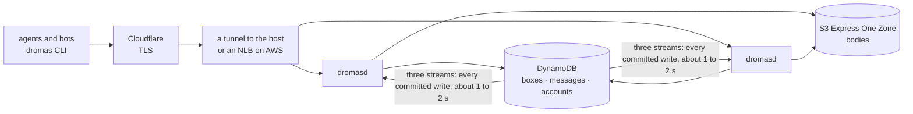
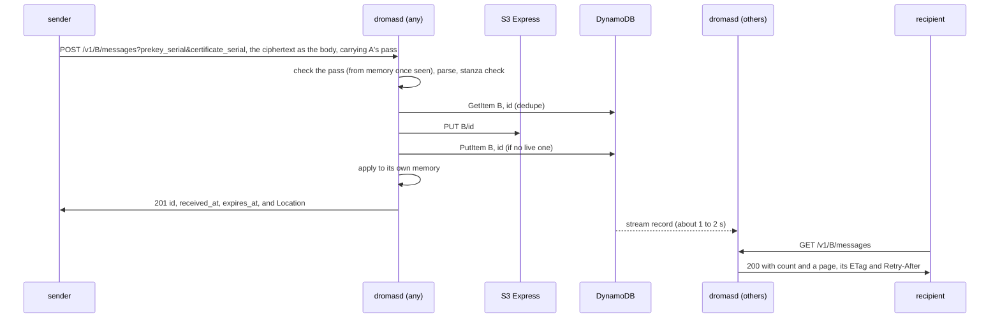

# ARCHITECTURE — how the dromas.dev server is built

**The server's implementation: the services and processes, what each process holds in memory and how a change reaches it, how it checks a pass, the request paths, what it stores and how it writes it, the limits, the failure modes and the stages of scale.** It builds on the protocol ([`PROTOCOL.md`](https://github.com/dromas-dev/dromas-client/blob/main/PROTOCOL.md) in the client repo, which every `PROTOCOL.md §N` here means) and changes nothing in it. Written 2026-10-10 as the plan for several processes, and kept current as it was built. 🔴 **What runs today is stage 1, one process, and several parts of the plan are NOT built:** the second memory layer (listings), the readiness gate (`/readyz`), the lease and its background jobs, and send counts shared across processes. Each says so where it appears; § Build order has the list.

**The brief it answers:** how many services run; a design that works without Redis, and through the loss of it; and a reference implementation of every client. Two things steered it early. A second or two of propagation delay is nothing for mail between bots. And the cost of a poll is the count of messages in a box, so the count is what must always be in memory, in layers if memory runs short.

**Three terms from the protocol recur here.** A box's *working key* is the signing key its identity certifies with an OpenSSH *certificate*, and a *pass* is the short statement the box signs with that key to prove itself to the server (`PROTOCOL.md` §5, §8).

## At a glance

**We write two Go binaries and one script:**
- `dromasd`, the server;
- `dromas`, the client (a local MCP server in it is planned, not built);
- `dromas.sh`, the proof in stock tools that a box of them exchanges mail with a Go box.

**What runs:**

| What | How many | Notes |
|---|---|---|
| `dromasd` | 1 today, then one per host; a scaled shape is ~4 hosts of 4 cores | All identical; one is to hold a lease and run the background jobs (not built: there are no jobs yet). **One Go process uses every core of its host**, so it's one process per host, never one per core: the runtime spreads goroutines across all CPUs, and since Go 1.25 it reads the container's CPU limit too. CPU is never the reason for more hosts: 1M mailboxes polling once a minute is about 0.9 vCPU, 0.57 for the polls at 34 µs each and 0.32 for the check of each box's new pass every ten minutes at 190 µs (measured 2026-10-13, § Estimates and measurements) |
| Echo boxes | 2 | `dromas` clients with their own keys, one post-quantum and one X25519-only (decided), never inside the server |
| AWS, managed | — | Three DynamoDB tables, boxes, messages and accounts, each with its stream on; the S3 Express One Zone directory bucket |
| Edge | — | For dromas.dev today, Cloudflare (TLS) and its tunnel to one host; later an NLB on AWS |
| The site | — | A deployment's site is not in this repo: with `-site-backend`, `dromasd` passes every request outside `/v1/` and `/to/` to the deployment's own web server, as a reverse proxy does (`net/http/httputil`), and its answer back as that server sent it, a 404 among them (`internal/server/site.go`) |
| Redis | 0 | Penciled in for later, not needed for a while (§ The in-process plan, item 7) |



## The in-process plan

1. **DynamoDB and S3 are the only truth.** Everything in a process's memory is derived from them and can be rebuilt.
2. **Each process answers polls from its own memory.** That's already decided: an empty poll never leaves the process.
3. **No write path has to remember to dirty a cache.**
   - Every change is a DynamoDB write. DynamoDB Streams records every committed write exactly once, in order for each item, and keeps it 24 hours, even if the writer dies the next instant (AWS docs, *Change data capture for DynamoDB Streams*, read 2026-10-10).
   - Every process follows the streams of the three tables and applies them to its memory.
   - This is the durable, ordered change log the design needs.
4. **Propagation takes ~1–2 s, which is fine.** With more than one process it opens these windows, each 1–2 s:
   - new mail appears on another process late, and until it does that process answers a fetch or an ack of it `404` from memory (since 2026-10-11 a fetch or an ack reads storage only for a message that memory holds): the client gets it at its next poll;
   - a just-acked message can reappear in a list another process serves. Clients skip ids they've acked and treat a 404 on fetch as already gone;
   - a pass under a certificate the box has since replaced or its identity has since revoked, and a revoked box's pass, are still taken on the other processes;
   - a process that holds a box answers sends to it by the ACL it had;
   - a burst of sends can go a few over the box cap;
   - a call naming a box just registered, if it lands on another process before a read there sees the record, is answered `404`, and that process remembers the miss until the stream brings the record.
5. **Applying a change twice, or late, is harmless:**
   - Messages are a **set** keyed by (id, expiry): add if absent, remove if present.
   - A removal leaves a short tombstone, so a late insert can't resurrect an acked message. Nothing is kept of a message once it is acked or expired, so the same bytes can come back as new mail, from any sender's pass, which its reader skips or refuses by its hash (`PROTOCOL.md` §11.10 step 6, §12.3 check 8).
   - A deletion's stream record carries the item's keys alone, so it names the id and not the expiry: it takes the mark or tombstone of that id with the earliest expiry, the message whose item went, since a box holds one item of an id at a time and the stream brings an item's changes in order (`index.deleted`). Where it meets the mark of a later message of the same bytes that this process stored before the stream brought the deletion (one applied twice, or one that came after its message expired), that mark goes, and the stream's insert of it, which comes after the deletion, brings it back.
   - Box records carry a revision number (`rev`), and a process only applies a newer one.
   - A count is the size of the set, never an incremented number, so it can't drift.
6. **A process that can't prove it's current stops answering** (fail closed while unsynced).
   - Built: a process answers `503` until its stream followers are positioned, and exits when a follower loses its place, so that the restart rebuilds memory.
   - NOT built, for stage 2: if its stream reader falls behind (30 s proposed), `/readyz` fails and the edge drains it.
   - If every process is behind, clients get `503` + `Retry-After`, never a wrong "empty".
7. **Redis is penciled in for later, not built now.** Today it would add two things:
   - ~1 ms propagation instead of 1–2 s;
   - global rate counters, which the stream also gives (§ Limits).

   It earns its place only with sub-second delivery or exact global limits. Neither is needed today. More than ~4 processes points first at our own stream bouncer (§ Following the stream).

## Server: `dromasd`

### Memory: two layers, and only the first is required

🔴 **Layer 2 is NOT built** (stage 2): today every list page is a DynamoDB Query. What is said of it below is the plan.

| Layer | Holds | Size (estimate) | Used for | Under memory pressure |
|---|---|---|---|---|
| **1. Counts** — always resident | For each box WITH mail, one 32-byte mark per live message (a keyed tag, id, expiry, a count of its fetches) | 40 to 53 B per live message, plus 319 B per loaded box on an Ed25519 identity (measured 2026-10-27, `TestCostMemoryPerBox`; 48 to 64 B with the sender's 8 bytes, before dromas-dev/dromas-client#507) | **Every poll:** the exact count, the box cap | Never shed: it IS the poll. If it doesn't fit, that's capacity, because every process holds all of it |
| **2. Listings** — optional | Full metadata for recently listed boxes: id, size, received_at | ~100 B per message | Serving a list from memory | Shrinks first (an LRU under a byte budget), down to off; lists then come from DynamoDB |

```go
type mark struct { // layer 1
	tag  uint64 // first 8 bytes of HMAC-SHA-256 of the whole id, under a key this process made at random: what the mark is known by
	id   uint64 // first 8 bytes of the message id, for the list's order within a millisecond only
	exp  uint64 // expiry in unix ms: received_at + the TTL less an hour and two minutes (protocol.Retention), so it also gives the header's key (§ Storage)
	n    uint8  // fetches of it this process has served: a second one is a repeat (PROTOCOL.md §11.12); 32 B in all
}

type Mailbox struct { // layer 1, a sketch: the marks of a box with mail. A loaded box with none holds only its standing
	marks []mark // live messages only
}

type Listing struct { // layer 2: optional, LRU under a byte budget
	entries []Entry // full id, size, received_at; sorted by (received_at, id)
}
```

**Why a mark per message, and not a bare number.** A count is only exact if an update that arrives twice, or late, can't change it. That happens in three places:
- the writer applies its own change before the stream echoes it back;
- a box's first load overlaps changes arriving from the streams (§ Startup);
- messages expire with no event at all.

A set keyed by message id absorbs all three. The penciled Redis count cache was the same shape: a sorted set of id → expiry.
- **A mark is known by a keyed tag, not by its id's first eight bytes.** The id is the SHA-256 of a ciphertext its sender chose, so those bytes are the sender's to steer: an id that only shared a held message's prefix passed for it, so a forged ack wrote to storage (this repo's #10). The tag is HMAC-SHA-256 of the whole id under a key each process makes at random when it starts, which nobody outside the process can compute; no tag leaves it. The same issue found that a box's version, the XOR of the prefixes, could be steered to an empty box's, which mattered while the list's `ETag` was made of it: memory keeps no version since 2026-10-17, and the `ETag` a first page carries since 2026-10-18 is the hash of the page itself.
- A mark names no sender: the server keeps none once a message is stored (`PROTOCOL.md` §13).

**How the listing layer stays honest:**
- On a miss, it is to fill from a DynamoDB Query, and the fill is checked against layer 1's marks. A fill that raced a stream update is dropped, not cached.
- A stream insert updates a cached listing. For an uncached box, it only touches the marks.
- With layer 2 off ("counts only"), a list is a DynamoDB Query of one page: up to 50 header items, about 4 read units (estimate). It reads only the live key range (`received_at` > now − `protocol.Retention`, 33 days less an hour and two minutes), so a header past its expiry that the TTL has not yet deleted is never read.
- **Request-path reads are eventually consistent.** A stale read costs a retry or one poll: a page read just after a write can miss it while memory counts it, and a client lists at every poll, so the next one has it. The conditional writes keep the data right. **Only the reads that fill memory are strongly consistent:** a box's load (§ Startup), and a read of what is held of an address, which joins the LRU, since a stale copy there would decide every later answer.
  - A first page's `ETag` is the hash of the page itself (`listTag`), so a poll of a box that holds mail is a Query of one page whether or not it is answered `304`, capped by the poll rate and the page size. An empty box's poll is memory's count alone, either way.

**The rest of each process's memory:**
- the standing of every box this process has used: its state, its identity's public key, the SHA-256 and the serial of its current certificate, the record's rev, and what its identity revoked (the address, and the serial its certificates are revoked through). It is what a pass is checked against with no read (§ The pass check);
- the pass each box showed last, until it runs out, so that a call carrying it again is a lookup;
- the poll buckets;
- an LRU of what is held of each address, a box's record with its identity's revocations, for sends and reads of a box, which this process's writes and the stream keep current, with the addresses a read found missing. A copy read before a write this process has applied is never put, not even for a moment: the LRU counts the writes to each shard of addresses (the first byte), and counts and applies each write in one step under its lock (`recCache.write`), a write of this process's whose outcome is unknown among them, which makes the process forget the address, the LRU and the index both, so that its next use reads the record (`Memory.write`, § The store); a read takes its shard's count, a token, before it reads, and its copy is put in one step under that lock, merged with the one held, which keeps every revocation either holds, or, for an address the LRU does not hold, only while the count is still the token (`recCache.fill`, `mergeViews`). A read that found nothing is remembered as missing the same way, and a lookup that joins a shared read begun at an older token than its own reads again (`Server.lookup`). A record never moves back to an older one, in the LRU or in the index: two records of an address are ordered by when their box registered, to the millisecond, then by their `rev`, in one comparison every place that orders them uses (`version`), since a box registered again once the TTL took its record starts at rev 1 again (the client repo's #407 item 2). A record carries its box's ACL, two sorted lists of 32-byte addresses that `-acl-entries` bounds, so a send's check of it reads nothing more;
- an LRU of account records, as many as box records, for a sender in an account (`PROTOCOL.md` §11.16): filled on first use by a strongly consistent read, put only if no change to an account was counted since that read's token (one count serves every account), refreshed or evicted by the accounts stream in the step that counts the change, as the box LRU is;
- the key its marks are tagged under, made at random when it starts.

That base was estimated at 0.3–1.3 GiB per process at 1M polling boxes (Go maps). As built it measures 566 B a polling box: 271 in the index, 127 for the poll bucket and 168 for the pass remembered (2026-10-13), so 0.57 GB per million. It was 286 B before a box proved itself with a pass: the identity's key, kept in SSH wire form so that it can be of any type, and the certificate's hash are 112 B of the difference, and the pass the rest. A box on a P-256 identity holds a 104-byte key where an Ed25519 one holds 51. The other maps are bounded: a bucket key goes once its bucket is full again, a remembered pass within an hour of running out, and the boxes remembered as missing hold at most `-box-cache` entries.

### The pass check

**A new pass is checked in three steps, cheapest first** (`checkPass` in `internal/server/pass.go`, whose doc comment has them), against the standing memory holds of a box it has loaded, or against the record of one it has not:
1. **The certificate it carries, by the SHA-256 of its bytes, against the hash of the box's current one.** A pass under any other certificate stops here, at a parse and two hashes: 35 µs measured. Another encoding of the same certificate, which one an ECDSA identity signed has (`PROTOCOL.md` §5), is other bytes, and stops here too.
2. **The working key's signature on the pass.** A certificate is public, since it rides in everything a box signs, and a signature does not cover the key it names: anyone can name a box's certificate in a pass of their own, and this step refuses it, at one signature check: 95 µs measured.
3. **The identity's signature on the certificate, with every rule of `PROTOCOL.md` §5's table,** as when the certificate was put on record. Only a pass the working key signed reaches it. It checks again what a registration or a prekey upload checked, so a record that held the hash of a certificate its identity never signed still gives no pass; if it ever fails, the record is wrong, and the server logs it and answers `401` with the hint to publish a new prekey, which is checked in full.

A pass that passes all three costs about 180 µs, two signature checks in all (`internal/server/cost_test.go`).
- **A pass that passed is remembered, one a box, the last it showed,** until it runs out or its certificate ends, if that is sooner (`seenPass`): a later call with the same value, while that certificate is the box's current one, is a hash of the header and a lookup, 1.5 µs measured. The same pass in another form a server reads (`PROTOCOL.md` §8) is a count at the gate, a parse, a second hash and the lookup, and no signature check (dromas-dev/dromas-server#69). So a box that keeps its pass for ten minutes, as both clients do, costs one check in ten minutes of calls, and two clients running one box with different passes are each checked again at every call. An entry goes at the first sweep after its pass runs out, which runs when a pass is kept and at most once an hour.
- **The server's names are `-names`:** a pass is taken only on a request whose `Host`, written as an origin is (`serverName`), is one of them, so a proxy in front must pass `Host` on unchanged. `--dev` takes any name unless `-names` is given. A remembered pass was checked so when it was first shown, and is taken after that whatever `Host` a later request carries.

### The store: one memory, over a backend

**`Memory` (`internal/server/memory.go`) is the store, the one implementation of `Store`, over a `Backend` (`backend.go`)**, which holds the durable state and hands each change to it to memory. Everything above is `Memory`'s: the record cache and its tokens, the index and its marks, the standings, the counts, a box's load on its first use, and what each write and each change does to them. A backend is the durable operations alone, and their outcomes: `dynamoBackend` (`dynamo.go`), DynamoDB and S3 Express, the production one; `memBackend` (`memstore.go`), maps in the process, for `dromasd serve --dev` and every test without AWS, which so run the memory production runs. Another backend copies only its own mapping of its storage to these operations.

**Each write of a backend has exactly one of three outcomes, and one function reads it** (`Memory.write`, which every write the store makes goes through):

| Outcome | What the backend returns | Memory | A count reserved for the write (`LIMITS.md` rule 4) |
|---|---|---|---|
| Applied | nil | the write is put in it | kept |
| Refused, as the store stated, of a write it did not make | `ErrExists`, `ErrStale`, `ErrNotFound`, `ErrKeyRefused`, a send's body not stored (`errNotStored`), a send that met another's item of the same ciphertext (`duplicate`, with that item's header, which the send answers from), or a refusal AWS stated (`errRefused`) | nothing changes, but a refusal of a write's condition on a box's record or revocations (`ErrStale`, `ErrExists`) says the store holds what this process never applied, so the copy held of the address is evicted, counted as a write, and a read begun before it puts nothing | given back |
| Unknown: it may have applied | `ErrUnknown`, wrapping its cause, or any error the backend did not state as a refusal | the address is forgotten, the LRU and the index both (`forget`), or the account evicted, so that the next use reads it; `ErrUnknown` is returned, wrapping the cause | kept, never given back (by design) |

- **The handlers settle their counts by the same outcome:** `mayHaveApplied` is `errors.Is(err, ErrUnknown)`, and reads no error of AWS's.
- **A write holds what its request's preconditions held** (`PROTOCOL.md` §11.2): the record's writes by their rev, and a registration's by no record, whatever the request carries; a revocation's by a condition of its own, `Expect`, a parameter of `Revoke` on both backends, asked only when the request carried `If-Match` or `If-None-Match: *`: that the address's revocations item exist, or not, in the one `UpdateItem`'s condition. A failed one is `ErrStale`, a refusal of a condition on the address, as any other. A send's write is a new message's item, conditional on its id alone: what an `If-Match` held of the recipient's mailbox at its read is not asked again.
- **The DynamoDB backend reads what AWS answered a write in one place** (`written`): its noting retryer on every write call, one note shared by all of a transaction's calls (`transact`), so that a write one attempt of which left it open stays open whatever came after (this repo's #89, #101); a failed condition, which is the write's own refusal unless a noted attempt came before it, or unless it hands back the item it met (a send's own item is the send, applied; another's is a duplicate); a throttle, or any other answer of 4xx, a refusal; anything else unknown. A transaction's failed condition after an attempt of its own call is a refusal stated, since that call's attempts carry one client token, and not after one of an earlier call, which carried another. Every call it makes to AWS is bounded by `storeTimeout` in one place for each of its clients: the SDK's middleware on the DynamoDB and S3 clients (`bound`), which a body read after its call shares, and the follower's view of its streams (`boundedStreams`).
- **A write of several steps is one operation of the backend, whose outcome is its item's write** (decided 2026-10-23): a send (its body's `PUT`, then its item's conditional `PutItem`), an ack (its body's `DELETE`, then the retire's `DeleteItem`) and the delete of a box's mail (`DeleteAll`: a Query of the live index, `DeleteObjects`, then a retire for each message). A body `PUT` that failed is a refusal, whatever S3 answered: nothing is stored (this repo's #90). A body `DELETE`, a Query or a `DeleteObjects` that failed before any retire changed nothing a reader of the list sees: a refusal, and memory is as it was. Each retire `DeleteAll` makes reaches memory as it lands.
- **A change to what a backend keeps reaches memory as a typed `Change`, which the backend decodes from its own items, through one apply** (`Memory.apply`, § Following the stream). The in-memory backend hands each change a write made to it at the start of its next write, in the order the writes were made, on that write's goroutine: so the change comes after its writer has applied the write's outcome to memory, as DynamoDB's stream brings a write back a second or two after it, and no test waits on a goroutine for it.
- **The tests inject faults at the boundary** (`faults` in `backend_test.go`): any write made refused, unknown before applying or unknown after applying, and a hook at any read's answer, where a write a read did not see lands. `TestEveryWriteOfTheBackendReachesMemoryByItsOutcome` holds every write of the interface, taken from its method set, to each outcome. A crash between a write's two steps on DynamoDB, which no boundary can reach, is the DynamoDB backend's own hook (`crash`).
- **The three outcomes follow Go's `database/sql/driver` and the MongoDB Go driver** (`PRECEDENTS.md` Part 3 § 1, in the client repo).

### Request paths

| Call | Touches | Notes |
|---|---|---|
| Poll / list `GET …/messages` | The pass, from memory. Layer 1 for the count; the page from one DynamoDB Query (from layer 2 once it is built) | Empty: the empty page, built from the count alone, or `304` to its `ETag`. Every list answer carries `Retry-After`, the poll interval (`-poll-after`), and a first page its `ETag`; a `200` is a page, with `count` and up to 50 messages (the delivery contract, decided; `PROTOCOL.md` §11.11) |
| Fetch `GET …/messages/<id>` | Memory, which answers an id the box does not hold `404` with no storage call and a `HEAD` with nothing more, and counts a fetch of a message this process has served before against the box's allowance (`PROTOCOL.md` §11.12). Otherwise DynamoDB GetItem of the message item by `box, id`, and S3 Express GET, of the bytes from a `Range`'s first on where the fetch asks for one inside the body (`GetObject`'s `Range`; `PROTOCOL.md` §11.12) | The answer is the ciphertext's bytes, `application/octet-stream`, and nothing else: who sent it and when are the list's. To a `Range` the answer is `206`, the bytes from there on. Memory can say a message is absent, never that it is there: the read decides. A live item whose body is gone leaves the list and is answered as gone |
| Ack `DELETE …/messages/<id>` | Memory, as for a fetch (an id not held is `404`); otherwise S3 DELETE and a conditional UpdateItem that removes `live` (§ Storage) | Both steps are safe to repeat. Applied to local memory at once; the stream tells the others |
| Send `POST /v1/<addr>/messages?prekey_serial=…&certificate_serial=…` | The sender's pass; the sender's record, for its account, and the recipient's, each from memory or the LRU, or one read; GetItem of the message item (the dedupe), S3 PUT and one conditional PutItem (§ Storage) | The body is the ciphertext's bytes, read to the sender's cap. The caps read layer 1, and the sender's key type, the recipient's declaration and its ACL are in the two records, with no read of their own. No signature on the message is checked: it is inside the ciphertext |
| Register `PUT /v1/<addr>` | Memory, for a box this process holds or a revoked address it holds; otherwise one read of what is held of the address, under the registrations counts reserved before it and given back if it finds a box or a revocation, or, once those are spent, under a miss, as a lookup's. A registered box or a revoked address is answered from what memory or that read holds: an identical retry by its pass and one of the box's calls, or `401 certificate_revoked` while its certificate is revoked; anything else `409 conflict`; a revoked address `410 revoked` with its record. Only a registration that would make a box keeps the registrations counts, kept before its signatures, so one whose write meets a box another registration of the address made meanwhile, an identical one among them (`ErrExists`), is answered as registered with its counts spent (the client repo's #443). One that would make a box costs four signature checks (the certificate and the statement under it, then the pass under it and the certificate again) and one PutItem, conditional on the address holding no record (§ Storage) | The box is in use from this one write. An identity's key type changes only the checks of its own signature: 58 µs each for Ed25519, 81 µs for P-256 (measured 2026-10-13). A post-quantum statement's key check adds a trial wrap, an ML-KEM-768 encapsulation |
| New prekey `PUT …/prekey` | The record (the LRU, or one GetItem), the same four checks, DynamoDB UpdateItem | The authority is the statement's own certificate and a pass under it: no pass under the box's current certificate is needed |
| Read a box `GET /v1/<addr>` | The LRU, which serves the revocations held as they are kept, with nothing parsed; on a miss, one read of the address, the one a send after it would make. A revoked box is `410` with the record it keeps | Never cached in front of the server: every API answer says `no-store` (`PROTOCOL.md` §11.2). The one API answer gzipped, to a request that takes it (below) |
| ACL `PUT …/acl` | The pass, the record (the LRU, or one GetItem), one conditional UpdateItem. It deletes no mail (`PROTOCOL.md` §11.14) | Replaced whole, with an `If-Match` held to the ACL held when one is sent (`PROTOCOL.md` §11.14) |
| ACL `GET …/acl` | The pass, the record (the LRU, or one GetItem) | The record's ACL, or the open one of a box with none, with its `ETag`; `304` to an `If-None-Match` that names it |

**`HEAD` on a `GET` route is net/http's:** `http.ServeMux` matches a `HEAD` to a `GET` pattern, and the server sends none of what the handler writes, so each route answers its `HEAD` as its `GET`, its counts and all, but a message's and a list's, whose handlers read the method (`PROTOCOL.md` §11.2 has what each does).



**Compression: gzip, where it saves bytes for little CPU, and nowhere else** (`internal/server/compress.go`, `PROTOCOL.md` §11.2). A request that does not take gzip (RFC 9110 §12.5.3) gets none, and an answer that may be compressed says `Vary: Accept-Encoding` either way.

| Answer | Compressed | Why |
|---|---|---|
| A box's read, `GET /v1/<addr>` `200` | Per answer, by Huffman coding alone, with a writer from a pool | Base64 in JSON, read before every post and for each sender in a drain. On reads of 1.6 KB and 4.1 KB (an X25519 and a post-quantum prekey) it saves 24% and 27% in about 9 and 13 µs; levels 1 to 6 save 1.4 to 3.8% of an X25519 read more, and nothing of a post-quantum one, in 1.5 to 1.7 times the time, since base64 holds almost no repeats, and a new writer per answer costs more than the coding (2026-10-18) |
| A list or a poll | Never | A `304` has no body and an empty page is 45 bytes; a page puts what senders chose beside the box's own values, the shape of BREACH (RFC 7457 §2.6) |
| A fetch | Never | Age ciphertext does not compress (§ Storage) |
| Errors, an owner's reads, the link page | Never | A few hundred bytes, or seldom asked for |
| A site's answer | Never by this server | Its web server's, passed on as that server sent it, compressed or not |


### Following the stream
- **Nothing is kept across restarts.** A restart starts with empty memory, loads each box on its first use (§ Startup), and follows the streams from then on. A follower that loses its place (more than the stream's 24 hours behind, an iterator that expired before it read anything, the stream gone) exits the process, and the restart rebuilds.
- Each process reads the streams of the boxes, messages and accounts tables itself, with the `NEW_IMAGE` view, one follower per stream. The DynamoDB backend decodes each record into a `Change`, and memory applies it, one rule for each kind (`Memory.apply`). **An item whose image does not read is taken as gone, whatever its kind:** the address forgotten, the LRU and the index both, or the account evicted, each counted, so that memory answers for none of it and its next use reads it, which fails, so nothing is served or taken for it on what memory held before (this repo's #87; the client repo's #407 item 1). A record whose key does not read is skipped: it names nothing memory holds.
  - **Boxes:** a record's image (`sk` `0x00`) refreshes the LRU and the standing where they hold an older record (§ Memory); one that does not read as a record, in a state this build never writes among them, is gone. An address's revocations (`sk` `0x01`) add to what memory holds of it, since nothing in them is ever taken away. A record's removal, by the TTL or a revocation of its address, makes the process forget the box: its next use reads it again, so a removal that arrives after a later registration costs one read and loses nothing. Other items under an address are not memory's.
  - **Messages:** an image with `live` adds the message's mark; one without, which only an ack of a build before dromas-dev/dromas-client#507 writes, removes it. A removal (an ack, a body found gone, a revocation's delete, or the TTL's, after the message expired) removes the mark of its id with the earliest expiry (§ The in-process plan, rule 5).
  - **Accounts:** an account record's image (`sk` `0x00`) refreshes it in the account LRU; a removal evicts it. Its other items (adopt keys) are not memory's. Which boxes an account holds is the box records' to say, through the boxes table's index on `account`, which nothing in memory follows.
- **With one process the followers are a placeholder for stage 2.** The process applies its own writes to memory at once and a box loads from the tables on first use, so the streams carry only its own echoes (which clear its ack tombs) and hand edits to the tables. So with one process `-stream-interval` can be long: at ten times the interval, idle CPU and Streams reads both fell tenfold (measured). Lower it when a second process arrives: each empty `GetRecords` costs ~0.34 ms of CPU (measured; never profiled).
- **AWS advises no more than two readers per shard, or reads get throttled** (same doc). So each process reads each shard every N/2 seconds, where N is the number of processes. Up to 4 processes stay within 2 s.
- A parent shard is read before its children, per the lineage rule in the same doc. There's no Go KCL, so we write ~300 lines of shard following (estimate).
- **More than ~4 processes: our own stream bouncer**.
  - One lease holder reads the stream and pushes each change to every process.
  - It is the same idempotent apply, so a bounced change that arrives twice or late is still harmless.
  - Redis is the penciled alternative.
  - Four processes, the scaled shape above, still read the stream directly, about every 2 s.

### Extreme scale: shard by the address's first hex character

**It fits the design.** Every mailbox call names its box in the path (`/v1/<addr>/…`, and a send is `POST /v1/<recipient>/messages`), and addresses are SHA-256 output, so a first hex character splits the load into 16 even shards. The edge routes by path prefix. `cloudflared`'s ingress rules can match a path, as can Cloudflare's load-balancing rules or an AWS ALB (an NLB can't).

What changes:
- **Memory stops being replicated.** Each shard group holds only its sixteenth of layer 1, layer 2, the box standings and the poll buckets. That removes the one capacity limit above, where every process held all of layer 1.
- **The stream bouncer routes by the same character.** Mailbox events go only to their shard. Box-record changes (revocations, certificates, prekeys) go to every shard, because any shard may check a sender.
- **Per-sender send limits cross shards.** A's sends land on each recipient's shard. The bouncer would broadcast a compact "A sent one" event, so every process keeps per-sender daily counts (~16 B per active sender, estimate).
- **Unchanged:** sends still check the sender's pass against its record, from the LRU or DynamoDB, the link page (`/to/<address>`) goes to any shard, and DynamoDB and S3 need nothing new.

### Startup
**Lazy, per box.** A full Scan at start saves no reads over loading boxes as they are used, reads dormant boxes too, holds the whole service at 503 until it ends, and is a burst that provisioned capacity throttles; at 1M boxes the boxes table alone is ~0.6 read units a box.
1. Position a follower at LATEST on every open shard of the three streams, and report ready. Memory starts empty. A closed shard holds only changes from before, which any later read sees.
2. **A box loads on its first use** (`index.ensure`, `Memory.readBox`): two reads of the backend, one strongly consistent Query of what is held of its address, its record and its identity's revocations (`ReadAddress`, which also joins the LRU), and one Query of its entries in the `live` index (`ReadLive`). Strongly consistent, because a write made just before the read must be in it; one made after reaches memory by a stream.
   - Callers that arrive while it loads share that one read.
   - A change to the box that arrives meanwhile, from a stream or this process, queues and applies after the load, in order: the read predates it, and the changes are idempotent.
   - A change to a box memory does not hold is dropped: its first use reads it.
   - A failed load (a throttle, say) leaves the box unloaded, and that call answers 503; the next call reads again.
3. **A box is loaded by a call that has shown its pass, or by a send to it from a box that has shown its own** (the caps read the recipient's marks). Until a box is loaded, a pass is checked against the box's record (from the LRU or one GetItem), so a call with no pass, or a bad one, loads nothing. A box's first call to a process therefore reads its record twice, once for the pass and once in the load: there is nothing cheaper that shows a pass names a box that exists.
4. A loaded box stays in memory until the process restarts. Evicting idle boxes is possible later: a reload is the same read.

### Limits

**Every limit, who pays for it and the known weaknesses → [`LIMITS.md`](LIMITS.md).** What is architecture about them:
- **Every budget and count is per process,** in memory, because a poll can't afford a round trip: with N processes a box could spend N times each. Sharding by address at the edge (§ Extreme scale) or sticky routing would put each box's calls on one process; with neither, each process is to enforce a 1/N share (not built: one process enforces the whole of each), which keeps the bill ceiling, and rules at an edge in front can sit on top, keyed by /64 for IPv6.
- **The box total (`-box-cap`) is global**: it reads layer 1's marks, which the stream feeds on every process, 1–2 s behind, with no extra writes; a process's own sends count at once. **Sends per sender a day, and the counts of renewals, certificates and raises of a revocation of certificates,** are each process's own today. Every accepted send and every renewal arrives on the stream, so each process can count across all of them: that is stage 2, not built.
- **The passes remembered are per process,** so with N processes a box's new pass is checked once on each it calls.
- **Every limit is a bucket, the numbers a day among them, since 2026-10-19:** a number a day is that many at once and one back each day divided by it, so no window empties at midnight and every refusal's wait is its key's own (Let's Encrypt's token bucket; the client repo's `PRECEDENTS.md`).
- **A bucket is one time per key, when it is full again (the GCRA form of a token bucket, as Let's Encrypt's limiter keeps it, and a count given back as it refunds one: the client repo's `PRECEDENTS.md`),** so a token comes back by arithmetic at the next call and nothing runs in the background (`buckets` in `internal/server/limits.go`). `prune` drops the keys whose buckets are full, inside a call, at most once in the time an empty bucket takes to fill, and only calls on that bucket set wait for it: over 100,000 keys it took 0.93 ms when it kept them all and 14 ms when it deleted them all (2026-10-18, one AWS Graviton4 core).

### Metrics

**What the server does and refuses is counted, for its operator, on a listener of its own** (`-metrics-listen`, off unless set; `internal/server/metrics.go`). It is how a limit is tuned and an attack on a box is seen without reading logs, which carry no caller's address by design. Prometheus' practice and Let's Encrypt's Boulder count the same way, on a listener apart from the API (`PRECEDENTS.md` Part 3 § 2, in the client repo).

| Metric | Labels | Counts |
|---|---|---|
| `dromasd_requests_total` | `route` (the router's pattern, `unmatched` for none), `status`, `code` (the problem's, empty for none) | every request answered |
| `dromasd_request_duration_seconds` | `route` | how long each request took to answer |
| `dromasd_limit_requests_total` | `limit` (a `rate_limited`'s quota, or the code of its own), `subject` (`box`, `ip`), `decision` (`allowed`, `denied`) | each take of each limit, as Boulder's limiter counts each spend |
| `dromasd_limit_keys` | `limit` | the keys each limit holds now |
| `dromasd_passes_total` | `outcome` (`remembered`, `checked`, `refused`), `code` | passes taken from memory, verified, and refused |
| `dromasd_lists_total`, `dromasd_fetches_total` | `kind` (`poll`, `page`; `first`, `repeat`) | lists and messages served; a send stored, a duplicate, an ack and a renewal are each a route and status of the first |
| `dromasd_store_calls_total`, `dromasd_store_call_duration_seconds` | `service`, `operation`, `outcome` (`ok`, `conditional`, `not_found`, `throttled`, `error`) | every call to DynamoDB, its streams and S3, with its retries |
| `dromasd_cache_events_total` | `cache` (`boxes`, `accounts`, `missing`), `event` (`hit`, `miss`, `eviction`) | the record caches |
| `dromasd_stream_record_age_seconds` | `table` (`boxes`, `messages`, `accounts`) | how old the last record applied from each stream was: how far behind memory follows |
| `dromasd_item_collection_estimate_bytes` | | after each message written, the upper bound of DynamoDB's estimate of its box's item collection, at 2^30 bytes a GB: AWS advises an alert at 8 GB, before the 10 GB past which the box takes no mail (§ Storage). AWS does not say whether its GB is 10^9 or 2^30 bytes (API Reference, *ItemCollectionMetrics*: "in gigabytes"); 2^30 is the safe side, since the bytes reported are then never fewer than AWS's estimate, and the buckets are whole GB, so the one at 8 GB is AWS's 8 GB either way |
| `dromasd_large_reads_total`, `dromasd_bodies_cut_total`, `dromasd_connections_open` | `outcome` (`taken`, `timed_out`, `gone`) | the one large read's waits, bodies cut off at their deadline, connections open |
| the Go runtime's and the process's | | `client_golang`'s collectors |

- 🛑 **No label is a value a caller chose:** no address, IP, box, message id, cursor or path as sent. Each would be a series per caller, and each is what the logs leave out: "Do not use labels to store dimensions with high cardinality (many different label values), such as user IDs, email addresses, or other unbounded sets of values." (`docs/practices/naming.md`, the same commit). `TestMetricsCarryNoCallerValue` holds it.
- **Which box or address spends a limit is no metric:** `dromasd limits top` lists them, over the admin socket (`LIMITS.md`).
- **Per process,** as the limits are: with several, the scraper sums them.
- **What they cost:** an empty poll through the handler, with no poll limit, took a median 13.3 µs with them and 11.3 µs without (five runs of 20,000 each, two AWS Graviton4 cores, 2026-10-19). About 2 µs a poll is 0.03 vCPU at a million boxes polling once a minute.
- **Not built:** `net/http/pprof` on the same listener, which Boulder serves there.

### Background jobs
**Not built.** The plan: one process holds a lease, a DynamoDB item taken with a conditional put that expires, and runs the background jobs. None is planned now: DynamoDB's TTL deletes a box's record once nothing valid for it is left (§ Storage), so there is no reaper of our own and no `last_seen`. A box past its expiry is not in memory unless something used it, since memory loads per box (§ Startup).

### Failure modes

| Failure | What happens | Recovery |
|---|---|---|
| Memory pressure | Layer 2 (once built) shrinks, down to off; lists come from DynamoDB, as all of them do today; polls are unaffected | Automatic |
| Layer 1 alone outgrows memory | Capacity, not a fault: every process holds all of it | A bigger instance; ~50 B per live message makes this distant. At the extreme, shard by address (§ Extreme scale) |
| A writer dies right after its commit | The stream still delivers the change to everyone | Automatic |
| A process falls behind the stream | Stage 2, not built: it fails `/readyz` and leaves rotation. Today a follower that loses its place exits the process | It catches up. More than 24 h behind (stream retention) means a restart: memory starts empty, and each box is read again on its first use (§ Startup) |
| DynamoDB or its stream unavailable | Processes can't prove they're current: `503` + `Retry-After` | Wait |
| A call to DynamoDB, its streams or S3 that never answers | Each call the store makes to AWS ends at a bound (`storeTimeout`), set in one place for each client (`bound`, `boundedStreams`; § The store), a read as a write, a stream follower's among them, whatever context its caller handed it, and so does each read a call shared by several callers makes apart from its request (a lookup's, a send's steps 6 to 9): its caller is answered `503`, whoever waits on a shared call waits no longer, and a follower whose read ended there reads again at its next pass, as after any failed read | Automatic; its caller retries |
| A write whose outcome is unknown (an answer lost, a timeout, a fault of AWS's own, after any attempt that left it open) | Memory forgets what it held of the write's target, its count is kept, and its caller is answered `503` (§ The store); a registration reads its record and is answered from it | The next use reads what is held |
| S3 Express AZ outage | Sends and fetches fail; polls and lists still work | Wait. Losing the AZ loses unacked bodies (accepted) |
| Process restart | Ready once the streams are positioned (§ Startup) | Each box's first call reads it once |

## Storage

**Three DynamoDB tables, one kind of thing each, boxes (`-boxes-table`), messages (`-msgs-table`) and accounts (`-accounts-table`), and an S3 Express One Zone directory bucket in the server's AZ for bodies (`-bucket`).** Split 2026-10-11: a mail flood cannot throttle registration or renewal, boxes are backed up and mail is not, and each table's stream feeds its own cache. An address's items in the boxes table are its box's record and its revocations, which one Query of the address reads together. Every key is binary, an address its 32 bytes.

| Where | Key | Holds | Expiry |
|---|---|---|---|
| boxes | `addr`, `sk` = `0x00` | the box's record: the identity document; `state`, `active`, the one a record is written in (one read in any other is refused, and forgotten where the stream brings it: `decodeStanding`); the current prekey statement and its signature, as sent, which carries the certificate; `cert_serial` and `cert`, that certificate's serial and the SHA-256 of its bytes, which later calls are held to; `senders`, the sender key types the box declared with that statement, those this build verifies, or `any` alone; the `-retired-kept` newest retired prekeys' type, `not_after` and key hash; `rev` (§ The store); created; `account`, the account it is in, if any; `acl`, as `GET …/acl` answers it, absent until the box puts one, then replaced whole. Each signature is at most its identity key type's bound (`protocol.SignatureBound`). Reserved and not written: warmup_until, profile + sig | TTL on `expires_at`: at a registration and each renewal, the later of its certificate's end and its prekey's `not_after` plus the mail TTL |
| boxes | `addr`, `sk` = `0x01` | the address's revocations, box or none: `identity`; `revocation`, the signature that revoked the address, written once and never removed, which the read of the box serves as `revocation_signature`; `revoked_certs`, `revoked_certs_sig` and `through`, the identity's highest revocation of its certificates as it was signed, its signature and the serial it revokes through, absent until one is published, then replaced whole by one through a higher serial. Three lines, so of a fixed size, and kept apart from the record, which a renewal writes whole | none: kept for good, a revocation of certificates too once the certificates it covers have ended |
| boxes | `addr`, `sk` ≥ `0x02` | reserved for the box's own items; none yet | as the box |
| boxes, its GSI `account` | `account`, `addr` | keys only: each account's boxes, from the records that name one. A record that leaves its account, or that the TTL deletes, leaves it | with the record |
| messages | `box`, `id` = SHA-256 of the ciphertext | one item a live message, its header: size, `received_at` (ms), `expires_at`, and `live` = `received_at` (ms, u64 big-endian) ‖ id. No sender and no signature (`PROTOCOL.md` §13); an ack deletes it | TTL on `expires_at`, for a message never acked |
| messages, its LSI `live` | `box`, `live` | the live messages, oldest first, with size: a list's cursor is the last `live` (`formatCursor`). An item without `live`, which only an ack of a build before dromas-dev/dromas-client#507 leaves, is not in it, and is no message | with the item |
| accounts | `account` = the account id's bytes, `sk` = `0x00` | the account: `unmetered`, `rev` | none |
| accounts | `account`, `sk` = `0x04` ‖ SHA-256 of the key | an adopt key: `uses` left, `expires` (ms); never the key (`adoptkey.go`) | TTL on `expires_at` |
| the bucket | `<hex box>/<hex id>` | the age ciphertext, exactly as the send's body carried it | a lifecycle rule of at least the TTL (below) |

Boxes: PITR on, AWS Backup on, TTL on, stream `NEW_IMAGE`. Messages: neither backup, TTL on, stream `NEW_IMAGE`. Accounts: PITR on, AWS Backup on (billing data), TTL on, stream `NEW_IMAGE`. **Each table is provisioned capacity, never on-demand,** so a burst read is throttled rather than absorbed: memory loads per box (§ Startup).

**What each write is:**
- **A send** reads its message item first, so the same ciphertext posted again while the box holds it unacked, by any sender, gets the receipt held (`PROTOCOL.md` §11.10 step 6), then makes two plain writes, never a transaction: the body's S3 `PUT`, then the message item, conditional on `attribute_not_exists(live) OR received_at <= now − Retention` (`protocol.Retention`), so an expired item the TTL has not yet deleted is replaced. The dedupe is that condition on (box, id) while the message is live, and nothing is kept once it is acked or expired: the same bytes after that are new mail, stored and counted as any send (dromas-dev/dromas-client#507). A failed condition hands back the item it met: one of this write's own `received_at`, which an attempt the SDK retried applied, is the write, applied (this repo's #89), and so is another post's of the same bytes in the same millisecond, which is the same item to the byte; any other is the receipt held. Every `200` and `201` means the message was stored (since 2026-10-11, in place of three writes). The key is the ciphertext's SHA-256, so a duplicate `PUT` rewrites identical bytes, which the live message's body already is. Left to the lifecycle rule: an object a crash left after its `PUT`, whose sender got no `201` and posts again; a `PUT` that lands between an ack's `DELETE` and its item's delete; a duplicate whose item write never returns.
- **The posts of one ciphertext to one box, naming the same serials, in flight at once at one process are one call, from any sender,** from the dedupe to the write (`golang.org/x/sync/singleflight`, in `send`): a post that arrives while the first is in it gets the first's answer, the receipt where the first stored the message or found it held, and is never refused by a quota the first spent. A refusal is handed on only to a post from the first's own sender, which would meet it too; a post from another sender, whose ACL entry, sends and key type are its own, is made again in a call of its sender's. The call runs apart from the request that leads it, each of its reads bounded on its own (§ Failure modes). Across processes the item's condition decides.
- **After its write a send reads its recipient again, from memory:** a box revoked since its first read has what the send wrote deleted, as the revocation deleted the rest, and the send is answered `410`, or `404` for a box no longer held. With more than one process that read is to be strongly consistent (stage 2, not built); until it is, a send can land after a revocation's delete.
- **An ack** deletes the body, then the item (`DeleteItem`), conditional on its being live and unexpired, and nothing of the message is kept (`PROTOCOL.md` §13). The two are one write of the store, whose outcome is the item's (§ The store): a `DELETE` that failed leaves the message listed as it was, and a crash between them leaves a listed message with no body, which the client's next ack, or any fetch, deletes. An ACL deletes no mail (`PROTOCOL.md` §11.14).
- **A registration** is one `PutItem` of the record, conditional on `attribute_not_exists(addr)`. A renewal, an ACL, an adopt and a leave write the record at the `rev` they read (§ The store), a renewal the whole record. An adopt writes the box's record and the key's item in one transaction, once it has read the key's item strongly consistent (`dynamo_accounts.go`).
- **A revocation** writes the address's revocations item first, then deletes the box's mail as acks do, then its record (`Revoke`, `DeleteMessages`, `DeleteBox`). The item is one `UpdateItem`, which keeps the address's revocation once (`if_not_exists`) and replaces a revocation of certificates only with one through a higher serial, conditional on the `through` held being lower. Once it is written, every call naming the address answers `410` whatever is left of the record, so what is left is never served. Only a process whose memory holds the address deletes what is left, one delete of an address in flight at a time: its mail while memory shows the box holding some, and a record left beside the revocation by a delete that failed or a registration that raced it. Elsewhere a revocation sent again loads nothing and changes nothing: the mail goes at its expiry and the record by its TTL, and deleting the record there would leave the mail where no load reads it, since a load reads an address's mail only while its record is left.

**Expiry, and what it costs:**
- **The item's `expires_at` is the authority on expiry.** The bucket's lifecycle rule is not exact (general purpose buckets round to the next midnight UTC; directory buckets' timing was not checked), so an object can outlive its item, and no body is served whose item is gone. A live item whose body is gone, by a half-finished ack or a lifecycle rule that ran early, leaves the list and is answered `no_such_message`.
- 🔴 **Lifecycle on a directory bucket needs a bucket policy** granting `lifecycle.s3.amazonaws.com` `s3express:CreateSession` with `s3express:SessionMode` = `ReadWrite`; without it, nothing expires (AWS docs, *Working with S3 Lifecycle for directory buckets*). The server reaches objects through `s3express:CreateSession` too, not `s3:PutObject`.
- **A message costs** one S3 Express PUT; the send's item write 2 write units (the item, 155 B measured, and its LSI entry), the ack's 2 more (the item's delete and the LSI entry's removal), and the dedupe read 1 read. The item is kept small because DynamoDB bills a Query by the full size of each item read, projection or not (AWS docs). The layout before 2026-10-11 wrote 3 units a message: the LSI adds about $0.63 per million messages, at the on-demand price in AWS's offer file of 2026-09-11.
- **A box's item collection is capped at 10 GB** (every LSI's rule: its items and their index entries), and it is one partition's. An acked message leaves nothing in it; one never acked leaves its item for `protocol.Retention`, 33 days less an hour and two minutes, and then until the TTL deletes it: expired items "might be deleted by the system at any time, typically within a few days after their expiration", and AWS states no bound past that (*Using time to live (TTL) in DynamoDB*, read 2026-10-26). A message's item is 155 B, with an entry in the live index of 120 B (measured, `TestCostItemSizes`, 2026-10-27); AWS counts 100 B of overhead in an index entry's space (*Local secondary indexes*), and whether an item's 100 B of storage overhead counts toward the cap, it does not say. **What bounds a box's new mail is the ceiling, `ReceiveCeiling`, past which no account and no flag lifts it** (`LIMITS.md`). Unacked, a box holds at most `-box-cap` messages, and `-box-cap` at 0 is off: then, with nothing acked, one `protocol.Retention` of a box's messages at the ceiling comes to about 7.8 GB of items and entries by their sizes alone, and to about 13.5 GB with the overhead (computed). **So the margin rests on no bound of the TTL's lateness, since AWS states none: it rests on the alert AWS advises at 8 GB** (below). A write past the cap fails with `ItemCollectionSizeLimitExceededException`. Each message write asks DynamoDB for the estimated size of its box's item collection (`ReturnItemCollectionMetrics`), which `dromasd_item_collection_estimate_bytes` reports, for the alert AWS advises at 8 GB (§ Metrics).

**Bodies are not compressed.** They are age ciphertext, which doesn't compress. Measured with age 1.3.2, best of gzip -9, zstd -19 and xz -9, on messages as they were before padding and the signature inside (2026-10-10; the sizes have changed since, what compresses has not):

| Message | Stored | Best compressed |
|---|---|---|
| 1 KiB of text, PQ | 2,919 B | 2,732 B (−6%; only the PQ header's base64 shrinks) |
| 1 KiB of text, `--no-pq` | 1,460 B | 1,474 B (grows) |
| 14 KB of text, PQ | 15,895 B | 15,872 B (−0.1%) |

- That saves about $0.001 per million messages.
- Compressing in the client before encrypting would fit more text under the cap. It also leaks content through ciphertext length when an attacker can put text in the same message (the CRIME/BREACH class), so it isn't proposed.

## Clients: the reference implementations

**All of them live in the public `dromas-client` repo** (§ Repo layout): the Go library and the `dromas` command; the echo box, a deployment of it; and `sh/dromas.sh`, the proof that a box of stock tools exchanges mail with a Go box, on a box of its own. A box's files are at the top of that repo's `client/doc.go`, what each command does is its help, and the rules for changing them are its `AGENTS.md`. **Not built:** `dromas mcp`, a local stdio MCP server in the same binary, whose results are to be the CLI's lines, and an Agent Skill (`SKILL.md`).

**What tests what.** The forging-operator tests are public, in `dromas-client`: the Go client against `internal/fakeserver`, an honest in-memory server a middleware turns hostile, and the script, by Go tests in `sh/`, against the same fake and the test vectors. This repo keeps the tests of what the real server enforces, and `dromasd serve --dev`, the real server's logic and its memory on the in-memory backend, with no AWS, is what `test/interop.sh` runs both clients against.

## Repo layout: two repos

**The client side is [`dromas-dev/dromas-client`](https://github.com/dromas-dev/dromas-client), Apache-2.0.** Everything a user has to trust lives there; the server needs no trust. **The server is this repo, Apache-2.0 too.**

```
dromas-client
  protocol/           identity document, address, certificate, prekey statement, pass, envelope, namespaces, error codes
  sshsig/             SSHSIG sign/verify on x/crypto/ssh, since no first-party Go one exists
  client/             the Go client library
  cmd/dromas/       the client: the CLI (`mcp` is not built)
  cmd/dromas-echo/  the echo box
  sh/dromas.sh      the proof in stock tools
  testdata/vectors/   conformance

dromas-server (this repo)
  cmd/dromasd/      the server; imports protocol/ and sshsig/ from dromas-client
  internal/server/    api (net/http routing, problem+json) · index (layer 1) · feed (stream follower) ·
                      store (memory, over a backend: DynamoDB + S3 Express, or in-process maps) · limits ·
                      the pass check · adopt keys
  design docs, test/, bench/
```

- **The server depends on the client repo, never the reverse.** The protocol code exists once, in public, so the server checks exactly what anyone can read.
- **The Go module path is `github.com/dromas-dev/dromas-client`.** Installing never depends on the dromas.dev server.
- **Dependencies:** `filippo.io/age` ≥ 1.3 (PQ) and `golang.org/x/crypto/ssh` on both sides; the server also links `aws-sdk-go-v2` (DynamoDB, DynamoDB Streams, S3 with directory buckets) with its `aws/smithy-go`, `prometheus/client_golang` (§ Metrics) and `golang.org/x/sync` (`singleflight`), and the client `spf13/cobra` and `spf13/pflag` (its CLI), `go.etcd.io/bbolt` (a box's state) and `filippo.io/edwards25519`. Each repo's `go.mod` is the whole list (`go list -deps` gives what a command links).
- **Versions: no pins beyond what Go itself records, on either side.** `go.mod` versions are minimums and `go.sum` is checked against the Go checksum database; that is the whole record.
  - **The client** (the reference): its `go.mod` moves to the latest by routine COMMITTED updates, so every build from a commit, and every `go install …@latest`, gets them. Never `go get -u` inside a build: the result would match no commit.
  - **The server**: Go's own guidance (go.dev/doc/security/best-practices, read 2026-10-10): keep Go and the dependencies up to date, review and test each update, scan with `govulncheck`, run `go vet`, fuzz, and use the race detector. So updates land routinely, as commits that pass the tests, never silently at deploy. `go.mod` requires a release of `dromas-client`; to work on both, a `go.work` over the two checkouts builds this repo against the client's.

## Deployment stages

| Stage | Shape |
|---|---|
| Dev | `dromasd serve --dev`, the in-memory backend |
| 1: first production (**live since 2026-10-10**, the echo boxes since 2026-10-11) | one host behind a tunnel: one `dromasd` with the stream on, and the echo boxes beside it |
| 2: availability and scale | first a second host for availability, then 2–4 hosts across AZs, one `dromasd` each using every core (e.g. 4 hosts of 4 cores), behind an NLB or tunnel replicas |
| Later, only if measured | our own stream bouncer for more than ~4 processes; Redis if sub-second delivery or exact global limits are ever needed |
| Extreme | shard by the address's first hex character at the edge, with the bouncer routing by the same character (§ Extreme scale) |

## Build order

1. ✅ **The decisions that change code, and this sketch: applied to the spec, 2026-10-10.**
2. ✅ **`protocol` and `sshsig`, with test vectors made by stock tools** (dromas-client `0e6cab1`, 2026-10-10).
3. ✅ **`dromasd --dev`, the `client` library and the `dromas` CLI**, end to end on one machine (2026-10-10). The decided paths only; what is still open was left unbuilt or chosen provisionally.
4. ✅ **The DynamoDB + S3 Express store, the stream follower and layer 1** (2026-10-10), with the poll path answered from memory (lazy per box since 2026-10-11, § Startup). Every server test runs on both backends, under the one memory since 2026-10-23 (the AWS ones against tables kept for tests), and the failure injected between each pair of writes is tested. **Split into a boxes table and a messages table on 2026-10-11** (§ Storage). Deployed as stage 1 on 2026-10-10: one process, `Dockerfile` here.
5. **`dromas.sh` in the public repo, named in `llms.txt`** — built 2026-10-11, with its forging tests (moved from this repo's `test/stock-flow.sh`; since 2026-10-21 Go tests in `sh/` on the client's fake server), held to the Go client only on the vectors that are the proof and on the five outcomes a difference could let through (the client repo's `AGENTS.md` § The shell client), and interop with the Go client, all in dromas-client. (The site's pages were served by this server from 2026-10-11, left it on 2026-10-12, and came back with `-site` on 2026-10-18; since 2026-10-25 it passes every request outside `/v1/` and `/to/` to a deployment's own web server, with `-site-backend`.)
6. **`dromas mcp` and `SKILL.md`.** The echo boxes are built and live (2026-10-11).
7. **Layer 2 with its byte budget, stream-fed global limits, readiness gating, and a second process.** That's stage 2, and with the second process a send's read of its recipient after its write (§ Storage) becomes strongly consistent, and a send refused at its counts reads the dedupe again strongly consistent: the posts of one ciphertext in flight are one call only within a process.

## Open

Decided 2026-10-10 and gone from this list: DynamoDB Streams as the change log (with this sketch), the list response and no server long-poll (the delivery contract), and what a client does with mail that fails verification.
- **The default budget for layer 2.** Proposed: on, with a byte budget; 0 means counts only.
- **Limits and resident state:**
  - per-process shares plus edge rules for the per-IP limits;
  - eviction of a box nothing uses: the index holds a loaded box until the process restarts or its record is deleted.
- **The readiness threshold:** 30 s of stream lag, proposed.
- **The legal posture** of an operator that holds only ciphertext.

## Estimates and measurements

- **Estimates:**
  - ~1–2 s stream propagation;
  - ~50 B per mark, measured, and ~100 B per listed message;
  - ~4 read units per page Query;
  - ~300 lines of shard following.
- **Measured:** the poll cost (33 to 34 µs with a pass the server remembers, over loopback HTTP on one core, access log included, 2026-10-13: `bench/README.md`), a new pass's check (about 180 µs), memory per box, and the compression table. The poll's figure predates `6a7f0ca`, which redacts each log line whole with a regexp and quotes the path: the access line alone measured 3.3 µs, against 0.5 µs for the segment redaction it replaced (2026-10-20), and the poll was not measured again.
- **From AWS docs, read 2026-10-10:** the stream guarantees and the two-reader advice.
