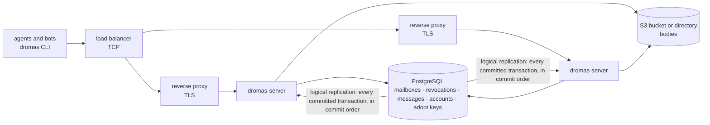
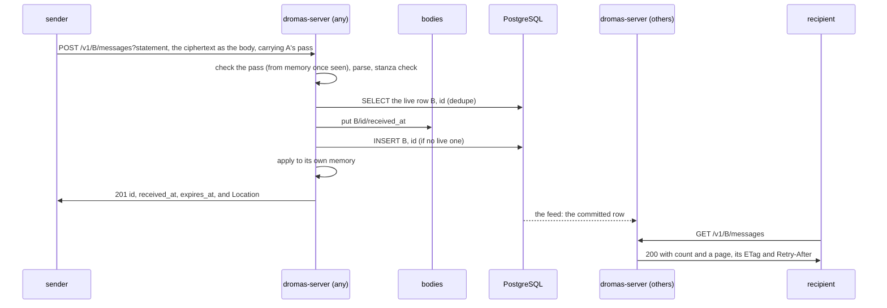

# ARCHITECTURE — how the dromas.dev server system is built

**`dromas-server` and the server system around it: the services and processes, what each process holds in memory and how a change reaches it, how it checks a pass, the request paths, what it stores and how it writes it, the limits, the failure modes and the stages of scale.** It builds on the protocol ([`PROTOCOL.md`](https://github.com/dromas-dev/dromas-client/blob/main/PROTOCOL.md) in the client repo, which every `PROTOCOL.md §N` here means) and changes nothing in it. It is also the plan for several processes. 🔴 **What runs today is stage 1, one process, and several parts of the plan are NOT built:** the second memory layer (listings), the readiness gate (`/readyz`), and send counts shared across processes. Each says so where it appears; § Build order has the list.

**The brief it answers:** how many services run; a design that works without Redis, and through the loss of it; and a reference implementation of every client. Two things steer it. A second or two of propagation delay is nothing for messages between bots. And the cost of a poll is the count of messages in a mailbox, so the count is what must always be in memory, in layers if memory runs short.

**Terms from the protocol recur here** (`PROTOCOL.md` §5, §8). A mailbox's *signer* is the key that signs what it says: its *identity*, or a *working key* the identity certifies with an OpenSSH *certificate*. A signer's *rank* is 0 for the identity and its serial for a certificate; a *revocation of certificates* through N ends every certificate at or below it, and never the identity. A *pass* is the short statement the mailbox's signer signs to prove itself to the server system.

## At a glance

**We write two Go binaries and one script:**
- `dromas-server`, the API process;
- `dromas`, the client (a local MCP server in it is planned, not built);
- `dromas.sh`, the proof in stock tools that a mailbox of them exchanges messages with a Go mailbox.

**What runs:**

| What | How many | Notes |
|---|---|---|
| `dromas-server` | 1 today, then one per host; a scaled shape is ~4 hosts of 4 cores | All identical; each runs the sweep, one process at a time by an advisory lock (§ The sweep), and each follows the database by a replication slot of its own (§ Following the feed). **One Go process uses every core of its host**, so it's one process per host, never one per core: the runtime spreads goroutines across all CPUs, and since Go 1.25 it reads the container's CPU limit too. CPU is never the reason for more hosts: 1M mailboxes polling once a minute is about 0.9 vCPU, 0.57 for the polls at 34 µs each and 0.32 for the check of each mailbox's new pass every ten minutes at 190 µs (measured 2026-10-13, § Estimates and measurements) |
| Echo mailbox | 1 | A `dromas` client with its own keys, never inside `dromas-server` |
| PostgreSQL | 1 | 15 or later, with `wal_level = logical`: five tables, mailboxes, revocations, messages, accounts and adopt keys, the one durable store of everything but bodies (§ Storage) |
| Bodies | — | An S3 bucket, a directory bucket or a general purpose one (`--bucket`), or a directory (`--bodies-dir`) |
| Edge | — | A load balancer passing TCP, then a reverse proxy that terminates TLS (for dromas.dev, an NLB and nginx on each host) and calls `dromas-server` over plain HTTP on one or more `--listen` addresses; `dromas-server` takes the client's address from the proxy's `X-Forwarded-For` (§ Behind a reverse proxy) |
| The site | — | A deployment's site is not in this repo: with `--site-backend`, `dromas-server` passes every request outside `/v1/` and `/to/` to the deployment's own web server, as a reverse proxy does (`net/http/httputil`), and its answer back as that server sent it, a 404 among them (`internal/server/site.go`) |
| Redis | 0 | Penciled in for later, not needed for a while (§ The in-process plan, item 7) |



## The in-process plan

1. **PostgreSQL and the bodies' store are the only truth.** Everything in a process's memory is derived from them and can be rebuilt.
2. **Each process answers polls from its own memory.** That's already decided: an empty poll never leaves the process.
3. **No write path has to remember to dirty a cache.**
   - Every change is a committed write to PostgreSQL, which its write-ahead log holds before the commit returns (`synchronous_commit` on, its default), even if the writer dies the next instant.
   - Every process follows that log by logical replication, one stream of every committed transaction to the published tables, in commit order (§ Following the feed), and applies it to its memory.
   - This is the durable, ordered change log the design needs.
4. **Propagation is as far behind as the feed** (`dromas_server_stream_record_age_seconds`, § Metrics). With more than one process it opens these windows, each that long:
   - a new message appears on another process late, and until it does that process answers a fetch or an ack of it `404` from memory (a fetch or an ack reads storage only for a message that memory holds): the client gets it at its next poll;
   - a just-acked message can reappear in a list another process serves. Clients skip ids they've acked and treat a 404 on fetch as already gone;
   - a pass under a certificate the mailbox has since replaced or its identity has since revoked, and a revoked mailbox's pass, are still taken on the other processes;
   - a process that holds a mailbox answers sends to it by the ACL it had;
   - a burst of sends can go a few over the mailbox cap;
   - a call naming a mailbox just registered, if it lands on another process before a read there sees the record, is answered `404`, and that process remembers the miss until the feed brings the record.
5. **Applying a change twice, or late, is harmless:**
   - Messages are a **set** keyed by (id, expiry): add if absent, remove if present.
   - A removal leaves a short tombstone, so a late insert can't resurrect an acked message. Nothing is kept of a message once it is acked or expired, so the same bytes can come back as a new message, from any sender's pass, which its reader skips or refuses by its hash (`PROTOCOL.md` §11.10 step 6, §12.3 check 8).
   - The feed's deletion of a message's row carries its key alone (`box`, `id`: the messages table's replica identity is its primary key), so it names the id and not the expiry: it takes the mark or tombstone of that id with the earliest expiry, the message whose row went, since a mailbox holds one row of an id at a time and the feed brings changes in commit order (`index.deleted`). Where this process holds a later message of the same bytes when the deletion arrives (one it stored, or one its load of the mailbox read, after an ack or the expiry of the first), it reads wrong until that message's own changes arrive, for as long as the process's feed lags: a mark the deletion takes leaves the mailbox counted one short, so a long poll on it can be answered an empty page, until the feed's insert of the message brings the mark back; a tombstone it takes, where this process acked the later message, lets that insert count a message that is gone, until its own deletion arrives (the client repo's #548 items 9 and 10).
   - Mailbox records carry a revision number (`rev`), and a process only applies a newer one. An image of a record that arrives onto what memory holds of an address with no record (its revocations alone, read since the record was deleted) has nothing to be compared with: it may be of the record this process deleted, its change behind the delete on the feed. Memory drops what it holds of the address instead, and the next use reads it (`Memory.apply`, `index.imageStanding`).
   - A count is the size of the set, never an incremented number, so it can't drift.
6. **A process that can't prove it's current stops answering** (fail closed while unsynced).
   - Built: a process answers `503` until its feed is synced through the moment it started, and while it has not been synced within `feedUnsyncedAfter` of now (`pgBackend.Ready`), and exits when the feed loses its place, so that the restart rebuilds memory. Synced through T means every transaction committed by T is applied, as the walsender's own position shows (§ Following the feed).
   - NOT built, for stage 2: a `/readyz` that fails with it, so that the edge drains the process.
   - If every process is behind, clients get `503` + `Retry-After`.
7. **Redis is penciled in for later, not built now.** Today it would add global rate counters, which the feed also gives (§ Limits). It earns its place only with exact global limits, which are not needed today.

## The process: `dromas-server`

### Memory: two layers, and only the first is required

🔴 **Layer 2 is NOT built** (stage 2): today every list page is a query of the messages table. What is said of it below is the plan.

| Layer | Holds | Size (estimate) | Used for | Under memory pressure |
|---|---|---|---|---|
| **1. Counts** — always resident | For each mailbox WITH messages, one 32-byte mark per live message (a keyed tag, id, expiry, a count of its fetches) | 40 to 53 B per live message, plus 319 B per loaded mailbox on an Ed25519 identity (measured 2026-10-27) | **Every poll:** the exact count, the mailbox cap | Never shed: it IS the poll. If it doesn't fit, that's capacity, because every process holds all of it |
| **2. Listings** — optional | Full metadata for recently listed mailboxes: id, size, received_at | ~100 B per message | Serving a list from memory | Shrinks first (an LRU under a byte budget), down to off; lists then come from the messages table |

```go
type mark struct { // layer 1
	tag  uint64 // first 8 bytes of HMAC-SHA-256 of the whole id, under a key this process made at random: what the mark is known by
	id   uint64 // first 8 bytes of the message id, for the list's order within a millisecond only
	exp  uint64 // expiry in unix ms: received_at + the TTL less an hour and two minutes (protocol.Retention), so it also gives the body's key (§ Storage)
	n    uint8  // fetches of it this process has served: a second one is a repeat (PROTOCOL.md §11.12); 32 B in all
}

type Mailbox struct { // layer 1, a sketch: the marks of a mailbox with messages. A loaded mailbox with none holds only its standing
	marks []mark // live messages only
}

type Listing struct { // layer 2: optional, LRU under a byte budget
	entries []Entry // full id, size, received_at; sorted by (received_at, id)
}
```

**Why a mark per message, and not a bare number.** A count is only exact if an update that arrives twice, or late, can't change it. That happens in three places:
- the writer applies its own change before the feed echoes it back;
- a mailbox's first load overlaps changes arriving from the feed (§ Startup);
- messages expire with no event at all.

A set keyed by message id absorbs all three. The penciled Redis count cache is the same shape: a sorted set of id → expiry.
- **A mark is known by a keyed tag, not by its id's first eight bytes.** The id is the SHA-256 of a ciphertext its sender chose, so those bytes are the sender's to steer: an id that only shared a held message's prefix would pass for it, so a forged ack would write to storage (this repo's #10). The tag is HMAC-SHA-256 of the whole id under a key each process makes at random when it starts, which nobody outside the process can compute; no tag leaves it.
- A mark names no sender: `dromas-server` keeps none once a message is stored (`PROTOCOL.md` §13).

**How the listing layer stays honest:**
- On a miss, it is to fill from a query of the messages table, and the fill is checked against layer 1's marks. A fill that raced a change from the feed is dropped, not cached.
- A change from the feed updates a cached listing. For an uncached mailbox, it only touches the marks.
- With layer 2 off ("counts only"), a list is one query of one page, up to 50 rows, in the order of the messages table's index on (`box`, `received_at`, `id`), which holds each row's size. It reads only the live range (`received_at` > now − `protocol.Retention`, the TTL less an hour and two minutes, a bind parameter from `dromas-server`'s clock), so a row past its expiry that the sweep has not yet deleted is never read.
- **Every read is of what is committed:** each statement reads what was committed before it began (PostgreSQL's READ COMMITTED), so a page read just after a write has it, and so does a mailbox's load (§ Startup), a read of what is held of an address, which joins the LRU, and the page of a list asked to wait (§ Behind a reverse proxy). `Backend.List`'s `consistent` is for a backend whose reads are not, and PostgreSQL's reads it as every read.
  - A first page's `ETag` is the hash of the page itself (`listTag`), so a poll of a mailbox that holds messages is a query of one page whether or not it is answered `304`, capped by the poll rate and the page size. An empty mailbox's poll is memory's count alone, either way.

**The rest of each process's memory:**
- the standing of every mailbox this process has used: its state, its identity's public key, the SHA-256 of its current signer's key (the identity's, or the certificate) and its rank, the record's rev, and what its identity revoked (the address, and the serial its certificates are revoked through). It is what a pass is checked against with no read (§ The pass check);
- the pass each mailbox showed last, until it runs out, so that a call carrying it again is a lookup;
- the poll buckets;
- an LRU of what is held of each address, a mailbox's record with its identity's revocations, for sends and reads of a mailbox, which this process's writes and the feed keep current, with the addresses a read found missing. A copy read before a write this process has applied is never put, not even for a moment: the LRU counts the writes to each shard of addresses (the first byte), and counts and applies each write in one step under its lock (`recCache.write`), a write of this process's whose outcome is unknown among them, which makes the process forget the address, the LRU and the index both, so that its next use reads the record (`Memory.write`, § The store); a read takes its shard's count, a token, before it reads, and its copy is put in one step under that lock, merged with the one held, which keeps every revocation either holds, or, for an address the LRU does not hold, only while the count is still the token (`recCache.fill`, `mergeViews`). A read that found nothing is remembered as missing the same way, and a lookup that joins a shared read begun at an older token than its own reads again (`Server.lookup`). A record never moves back to an older one, in the LRU or in the index: two records of an address are ordered by when their mailbox registered, to the millisecond, then by their `rev`, in one comparison every place that orders them uses (`version`), since a mailbox registered again once the sweep took its record starts at rev 1 again (the client repo's #407 item 2). A record carries its mailbox's ACL, two sorted lists of 32-byte addresses that `acl_entries` bounds, so a send's check of it reads nothing more;
- an LRU of account records, as many as mailbox records, for a sender in an account (`PROTOCOL.md` §11.16): filled on first use by a read, put only if no change to an account was counted since that read's token (one count serves every account), refreshed or evicted by the feed's changes to the accounts table in the step that counts the change, as the mailbox LRU is;
- the key its marks are tagged under, made at random when it starts.

That base measures 566 B a polling mailbox: 271 in the index, 127 for the poll bucket and 168 for the pass remembered (measured 2026-10-13), so 0.57 GB per million. The identity's key, kept in SSH wire form so that it can be of any type, and the signer's hash are 112 B of it. A mailbox on a P-256 identity holds a 104-byte key where an Ed25519 one holds 51. The other maps are bounded: a bucket key goes once its bucket is full again, a remembered pass within an hour of running out, and the mailboxes remembered as missing hold at most `--mailbox-cache` entries.

### The pass check

**A new pass is checked in three steps, cheapest first** (`checkPass` in `internal/server/pass.go`, whose doc comment has them), against the standing memory holds of a mailbox it has loaded, or against the record of one it has not:
1. **The signing key it carries, by the SHA-256 of its bytes, against the hash of the mailbox's current signer's, the certificate where it is one, and then of its identity's,** whose pass is always taken (`PROTOCOL.md` §8). A pass by any other key stops here, at a parse and a few hashes: 35 µs measured. Another encoding of the same certificate, which one an ECDSA identity signed has (`PROTOCOL.md` §5), is other bytes, and stops here too: `certificate_not_current`, naming the current certificate's serial where there is one, and `certificate_revoked` while the current certificate is revoked, when only the identity's pass is taken (`otherSigner`).
2. **The signature on the pass.** The signing key is public, since it rides in everything a mailbox signs, and a signature does not cover the key it names: anyone can name a mailbox's key in a pass of their own, and this step refuses it, at one signature check: 95 µs measured.
3. **The signer against the identity on record:** a certificate by the identity's signature on it, with every rule of `PROTOCOL.md` §5, as when it was put on record; the identity by its key, byte for byte. Only a pass that signer's key signed reaches it. It checks again what a registration or a prekey upload checked, so a record that held the hash of a certificate its identity never signed still gives no pass; if it ever fails, the record is wrong, and `dromas-server` logs it and answers `401` with the hint to publish a new prekey, which is checked in full.

A pass under a certificate that passes all three costs about 180 µs, two signature checks in all; the identity's pass costs one.
- **A pass that passed is remembered, one a mailbox, the last it showed, with the key it was checked under,** until it runs out or its certificate, if it is under one, ends, if that is sooner (`seenPass`): a later call with the same value, while that key is the identity's or the mailbox's current certificate, not revoked, is a hash of the header and a lookup, 1.5 µs measured. The same pass in another header a server system reads (`PROTOCOL.md` §8), or with a P-256 signature's other `s`, which ECDSA takes (§3.2), is a count at the gate, a parse, a second hash and the lookup, and no signature check: memory keys a pass by `protocol.Pass.Authorization`, which writes `s` low (dromas-dev/dromas-server#69). A signature in any other form is no pass. So a mailbox that keeps its pass for ten minutes, as both clients do, costs one check in ten minutes of calls, and two clients running one mailbox with different passes are each checked again at every call. An entry goes at the first sweep after its pass runs out, which runs when a pass is kept and at most once an hour.
- **`dromas-server`'s names are `--names`:** a pass is taken only on a request whose `Host`, written as a server name (`serverName`, `protocol.ServerName`), is one of them, and `dromas-server` refuses a name in `--names` that carries port 80 or 443. So a proxy in front must pass `Host` on unchanged, a port that is neither of those included. `--dev` takes any name unless `--names` is given. A remembered pass was checked so when it was first shown, and is taken after that whatever `Host` a later request carries.

### The store: one memory, over a backend

**`Memory` (`internal/server/memory.go`) is the store, the one implementation of `Store`, over a `Backend` (`backend.go`)**, which holds the durable state and hands each change to it to memory. Everything above is `Memory`'s: the record cache and its tokens, the index and its marks, the standings, the counts, a mailbox's load on its first use, and what each write and each change does to them. A backend is the durable operations alone, and their outcomes: `pgBackend` (`postgres.go`, `postgres_feed.go`, `postgres_sweep.go`), PostgreSQL with bodies in a bucket or a directory (`bodies.go`), the production one; `memBackend` (`memstore.go`), maps in the process, for `dromas-server serve --dev` and every test without PostgreSQL, which so run the memory production runs. Another backend copies only its own mapping of its storage to these operations.

**Each write of a backend has exactly one of three outcomes, and one function reads it** (`Memory.write`, which every write the store makes goes through):

| Outcome | What the backend returns | Memory | A count reserved for the write (`LIMITS.md` rule 4) |
|---|---|---|---|
| Applied | nil | the write is put in it | kept |
| Refused, as the store stated, of a write it did not make | `ErrExists`, `ErrStale`, `ErrNotFound`, `ErrKeyRefused`, a send's body not stored (`errNotStored`), a send that met another's row of the same ciphertext (`duplicate`, with that row's header, which the send answers from), or a refusal PostgreSQL stated (`errRefused`, by `pgOutcome`) | nothing changes, but a refusal of a write's condition on a mailbox's record or revocations (`ErrStale`, `ErrExists`) says the store holds what this process never applied, so the copy held of the address is evicted, counted as a write, and a read begun before it puts nothing | given back |
| Unknown: it may have applied | `ErrUnknown`, wrapping its cause, or any error the backend did not state as a refusal | the address is forgotten, the LRU and the index both (`forget`), or the account evicted, so that the next use reads it; `ErrUnknown` is returned, wrapping the cause | kept, never given back (by design) |

- **The handlers settle their counts by the same outcome:** `mayHaveApplied` is `errors.Is(err, ErrUnknown)`, and reads no error of PostgreSQL's.
- **A write holds what its request's preconditions held** (`PROTOCOL.md` §11.2): the record's writes by their rev, and a registration's by no record, whatever the request carries; a revocation's by a condition of its own, `Expect`, a parameter of `Revoke` on both backends, asked only when the request carried `If-Match` or `If-None-Match: *`: that the address's revocations row exist, or not, in the one statement's condition. A failed one is `ErrStale`, a refusal of a condition on the address, as any other. A send's write is a new message's row, conditional on its id alone: what an `If-Match` held of the recipient's mailbox at its read is not asked again.
- **The PostgreSQL backend reads what PostgreSQL answered a write in one place** (`pgOutcome`): nil is applied; an `ERROR` of the database's own (a `PgError` of that severity, not of a connection's end, classes `08` and `57P`), after which the statement, or the transaction, its `COMMIT` included, rolled back, is a refusal stated, and so is a write pgx never sent (a connection never made, `pgconn.SafeToRetry`); anything else is unknown: a `FATAL` or a `PANIC`, which can follow a commit (`xact.c`: "cannot abort transaction %u, it was already committed"), an answer lost, a context that ended mid-statement, a `COMMIT` with no answer. A row a write returns is decoded once its transaction has committed, so one that does not read is the write applied with an answer that does not read: unknown. Every connection of the pool runs with `synchronous_commit = on`, so a write is answered only once its WAL is flushed, which the feed's "synced through" reads (§ Following the feed). pgx retries nothing it sent, so one attempt is the whole write. A write of more than one statement is one transaction (`pgBackend.write`), in which an outcome a statement states (`ErrStale`, `ErrKeyRefused` and the like) rolls back. Every statement is bounded by `storeTimeout`, whatever context its caller handed it (`bounded`), and every call to S3 by the same bound, set once on its client (`bound`), which a body read after its call shares.
- **A write of several steps is one operation of the backend, whose outcome is its row's write**: a send (its body's put, then its row's conditional `INSERT`), an ack (its row's conditional `DELETE`, then its body's delete) and the delete of a mailbox's messages (`DeleteAll`: every live row of the mailbox in one `DELETE … RETURNING`, then their bodies). A body put that failed is a refusal, whatever the bodies' store answered: nothing is stored (`errNotStored`; this repo's #90). A body delete that fails once its row is gone is logged and changes nothing of the outcome: the body is an orphan, collected by age (§ Storage). Each message `DeleteAll` takes reaches memory once its statement has.
- **A change to what a backend keeps reaches memory as a typed `Change`, which the backend decodes from its own rows, through one apply** (`Memory.apply`, § Following the feed). The in-memory backend hands each change a write made to it at the start of its next write, in the order the writes were made, on that write's goroutine: so the change comes after its writer has applied the write's outcome to memory, as the feed brings a write back after its commit, and no test waits on a goroutine for it.
- **The tests inject faults at the boundary** (`faults` in `backend_test.go`): any write made refused, unknown before applying or unknown after applying, and a hook at any read's answer, where a write a read did not see lands. `TestEveryWriteOfTheBackendReachesMemoryByItsOutcome` holds every write of the interface, taken from its method set, to each outcome. A crash between a write's two steps on PostgreSQL, which no boundary can reach, is the PostgreSQL backend's own hook (`crash`: after a send's body, after an ack's row).
- **The three outcomes follow Go's `database/sql/driver` and the MongoDB Go driver** (`PRECEDENTS.md` Part 3 § 1, in the client repo).

### Behind a reverse proxy

`dromas-server` speaks plain HTTP; TLS ends in a reverse proxy in front (dromas-dev/dromas-server#124). That keeps TLS above `dromas-server`, so a restart of `dromas-server` drops no client's TLS session, and it is where routing by a mailbox's address goes once there is more than one process (§ Routing by address).
- **The client's address** is the last entry of `X-Forwarded-For` from a peer in `--trusted-proxy`, the one that proxy wrote of the connection it took (`clientIP`); every entry before it is the caller's own word and is never read, and from any other peer the header is ignored. Every per-IP limit keys on it (`LIMITS.md`), and the site is told it (`--site-backend`), with every other header a proxy or CDN names a client by dropped.
- **`Host` is passed on unchanged** (§ The pass check), and `X-Forwarded-Proto` from a trusted proxy says the scheme (the link page's).
- **A long poll holds nothing of `dromas-server`'s but its goroutine and its connection:** no write deadline runs while it waits (the pacing sets one on each write, and the answer's is set as it is written), `--idle-timeout` is for the time between requests, and a connection `--listen` accepts sends no TCP keep-alive probes (`listenAll`), as nginx leaves a listening socket's to the operating system's default, since each phase of a connection has a bound of its own. Every change memory applies to a mailbox, a write of this process or one from the feed, passes through the index's `apply`, `imageStanding` or `forget`, which wake the long polls on it (`TestEveryChangeMemoryAppliesToAMailboxWakesItsLongPolls`, from the backend's writes and its feed's kinds); a long poll on one process is woken by a send stored on another through the feed (`TestTwoProcesses`). A message's expiry is no change memory applies: a long poll's wait ends at its mailbox's first expiry, by the store's clock, and its page is read again. The page of a list asked to wait reads what is committed (§ Memory), so a list is never held on a page that misses a change memory had applied. When the API's `http.Server` shuts down (SIGTERM), `RegisterOnShutdown` answers every long poll `304` at once (`StopHolds`, wired where that `http.Server` is made: `Server.HTTPServer`), so its clients list again at once and `Shutdown` waits for none of them.
- **Several listen addresses** (`--listen`, comma-separated) are served by one `http.Server`: each connection the proxy holds to `dromas-server` is one 4-tuple, so one proxy address calling one `dromas-server` address is bounded by the proxy host's range of ephemeral ports, and every address more is one range more. A held request (a long poll, the client repo's #510) holds one for its whole wait.
- **`--idle-timeout` above the proxy's own idle timeout for its upstream connections** (`LIMITS.md`), so the proxy closes first.
- **What a proxy does that `dromas-server` also does:** a proxy that buffers a request's body before passing it (nginx's default) keeps a slow upload off `dromas-server`'s large read and its bodies open before a pass; `dromas-server`'s own header and body timeouts and every count stand whatever is in front (`LIMITS.md`), and only `dromas-server` counts a caller by its IPv6 /64 and /48.

### Request paths

| Call | Touches | Notes |
|---|---|---|
| Poll / list `GET …/messages` | The pass, from memory. Layer 1 for the count; the page from one query of the messages table (from layer 2 once it is built) | Empty: the empty page, built from the count alone, or `304` to its `ETag`. Every list answer carries `Retry-After`, the poll interval (`poll_after`), and a first page its `ETag`; a `200` is a page, with `count` and up to 50 messages (the delivery contract, decided; `PROTOCOL.md` §11.11). **Held** (a long poll, `wait`): where the answer would be `304`, the handler takes the mailbox's change channel from memory (`Store.Changed`) before it reads, then waits on it, its mailbox's first expiry (`Store.NextExpiry`), its wait (at most `max_wait`), the caller's leaving, `dromas-server`'s stopping or a later list of its mailbox, which is held in its place (one a mailbox, and at most `max_long_polls_per_range` for the callers of one IPv4 address or IPv6 /48: `holds`), and reads again; it reads nothing while it waits, and its page reads what is committed |
| Fetch `GET …/messages/<id>` | Memory, which answers an id the mailbox does not hold `404` with no storage call and a `HEAD` with nothing more, and counts a fetch of a message this process has served before against the mailbox's allowance (`PROTOCOL.md` §11.12). Otherwise one read of the message's live row by (`box`, `id`), then its body, of the bytes from a `Range`'s first on where the fetch asks for one inside the body (a bucket's `GetObject` with that `Range`, a file read from that offset; `PROTOCOL.md` §11.12) | The answer is the ciphertext's bytes, `application/octet-stream`, and nothing else: when it came is the list's, and who sent it is the signature's, inside the ciphertext. To a `Range` the answer is `206`, the bytes from there on. Memory can say a message is absent, never that it is there: the read decides. A live row whose body is gone (`errNoBody`) leaves the list and is answered as gone |
| Ack `DELETE …/messages/<id>` | Memory, as for a fetch (an id not held is `404`); otherwise the row's conditional `DELETE`, then the body's delete (§ Storage) | Both steps are safe to repeat. Applied to local memory at once; the feed tells the others |
| Send `POST /v1/<addr>/messages?statement=…` | The sender's pass; the sender's record, for its account, and the recipient's, each from memory or the LRU, or one read; one read of the message's row (the dedupe), the body's put and one conditional `INSERT` (§ Storage) | The body is the ciphertext's bytes, read to the sender's cap. The caps read layer 1, and the sender's key type, the recipient's declaration and its ACL are in the two records, with no read of their own. No signature on the message is checked: it is inside the ciphertext |
| Register `PUT /v1/<addr>` | Memory, for a mailbox this process holds or a revoked address it holds; otherwise one read of what is held of the address, under the registrations counts reserved before it and given back if it finds a mailbox or a revocation, or, once those are spent, under a miss, as a lookup's. A registered mailbox or a revoked address is answered from what memory or that read holds: an identical retry by its pass and one of the mailbox's calls, or `401 certificate_revoked` while its revocation of certificates covers its signer; anything else `409 conflict`; a revoked address `410 revoked` with its record. Only a registration that would make a mailbox keeps the registrations counts, kept before its signatures, so one whose write meets a mailbox another registration of the address made meanwhile, an identical one among them (`ErrExists`), is answered as registered with its counts spent (the client repo's #443). One that would make a mailbox costs, under a certificate, four signature checks (the certificate and the statement under it, then the pass under it and the certificate again), and two by the identity, and one `INSERT`, conditional on the address holding no record (§ Storage) | The mailbox is in use from this one write. An identity's key type changes only the checks of its own signature: 58 µs each for Ed25519, 81 µs for P-256 (measured 2026-10-13). A post-quantum statement's key check adds a trial wrap, an ML-KEM-768 encapsulation |
| New prekey `PUT …/prekey` | The record (the LRU, or one read), the same checks, one `UPDATE` at the record's rev | The authority is the statement's own signer and a pass by it: no pass by the mailbox's current signer is needed |
| Read a mailbox `GET /v1/<addr>` | The LRU, which serves the revocations held as they are kept, with nothing parsed; on a miss, one read of the address, the one a send after it would make. A revoked mailbox is `410` with the record it keeps | Never cached in front of `dromas-server`: every API answer says `no-store` (`PROTOCOL.md` §11.2). The one API answer gzipped, to a request that takes it (below) |
| ACL `PUT …/acl` | The pass, the record (the LRU, or one read), one `UPDATE` at the record's rev. It deletes no messages (`PROTOCOL.md` §11.14) | Replaced whole, with an `If-Match` held to the ACL held when one is sent (`PROTOCOL.md` §11.14) |
| ACL `GET …/acl` | The pass, the record (the LRU, or one read) | The record's ACL, or the open one of a mailbox with none, with its `ETag`; `304` to an `If-None-Match` that names it |

**The version policy comes first under `/v1/`** (`versioned`, `internal/server/version.go`; `PROTOCOL.md` §11.17, §11.4 rule 0). It wraps the API's router, inside `notStored` and in front of `unrouted` and every route's gate, and reads only `Dromas-Version` (`protocol.RequestVersion`: none, or another form, is `0.0.0`). It sets `Deprecation` and `Sunset` on the answer, whatever its status, where the policy covers the version, and counts the request by its state (§ Metrics). A version below the policy's floor, or covered by a sunset whose time has passed at `dromas-server`'s clock, spends its address's flood budget (`spendRequest`) and is answered `410 version_retired`, with `min_version` where there is a floor, before any route is matched; `dromas-server`'s document, `GET /v1/`, takes every version and answers the policy, the same to every caller, with no pass. The policy is `--version-policy`'s file, of the runtime-config directory (§ Runtime config), held to `protocol.ServerDocument.Check`; a request reads the policy in force once, as it arrives (`atomic.Pointer`), so a reload swaps it whole between requests and drops no connection.

**`HEAD` on a `GET` route is net/http's:** `http.ServeMux` matches a `HEAD` to a `GET` pattern, and `dromas-server` sends none of what the handler writes, so each route answers its `HEAD` as its `GET`, its counts and all, but a message's and a list's, whose handlers read the method (`PROTOCOL.md` §11.2 has what each does).



**Compression: gzip, where it saves bytes for little CPU, and nowhere else** (`internal/server/compress.go`, `PROTOCOL.md` §11.2). A request that does not take gzip (RFC 9110 §12.5.3) gets none, and an answer that may be compressed says `Vary: Accept-Encoding` either way.

| Answer | Compressed | Why |
|---|---|---|
| A mailbox's read, `GET /v1/<addr>` `200` | Per answer, by Huffman coding alone, with a writer from a pool | Base64 in JSON, read before every post and for each sender in a drain. On reads of 1.6 KB and 4.1 KB (an X25519 and a post-quantum prekey) it saves 24% and 27% in about 9 and 13 µs; levels 1 to 6 save 1.4 to 3.8% of an X25519 read more, and nothing of a post-quantum one, in 1.5 to 1.7 times the time, since base64 holds almost no repeats, and a new writer per answer costs more than the coding (measured 2026-10-18) |
| A list or a poll | Never | A `304` has no body and an empty page is 45 bytes; a page puts what senders chose beside the mailbox's own values, the shape of BREACH (RFC 7457 §2.6) |
| A fetch | Never | Age ciphertext does not compress (§ Storage) |
| Errors, an owner's reads, the link page | Never | A few hundred bytes, or seldom asked for |
| A site's answer | Never by `dromas-server` | Its web server's, passed on as that server sent it, compressed or not |


### Runtime config

**The files of the runtime-config directory are read at start and kept in force while `dromas-server` runs** (`Reloader`, `internal/server/runtimeconfig.go`): `--limits` (`internal/server/limitsfile.go`) and `--version-policy`. A setting lives in one of them or is a flag, never both, as Prometheus keeps its flags for what cannot change while it runs (`docs/configuration/configuration.md`, read 2026-11-06). The directory, `/config/` in the container, is bind-mounted as a directory, read-only: a single-file bind mount follows the file's inode, so a save by rename is never seen there (`README.md`).
- **Read again at once on SIGHUP,** as Prometheus reloads `--config.file`, whatever its bytes, **and every minute** (`ReloadEvery`), whatever the file's metadata says, since a Kubernetes ConfigMap changes its directory mount by a symlink swap and sends no signal, and a modification time's resolution and a rewrite of the same size defeat a check of metadata. The minute's read changes nothing where the bytes are those read last.
- **Each read is bounded** (`MaxLimitsFile`, `MaxVersionPolicy`: a few KiB past the largest file of each form, written with indents); a larger file is a failed reload.
- **The limits are put in force whole** (`setLimits`): the `Limits` in force swap at once, every bucket takes its new size under its lock and keeps its keys, and the server's document takes the new `max_certificate_lifetime`; the version policy's reload holds the same lock, since both make that document. `Server.limits` hands each read a copy of the limits in force.
- **A reload that fails keeps what is in force,** logs one line naming the path and why, never the file's contents, and counts `failed`; one that succeeds swaps the value in whole (`atomic.Pointer`), logs that it loaded, and counts `ok`. A file that fails at start stops `serve`, naming its flag.

### Following the feed
- **Nothing is kept across restarts.** A restart starts with empty memory, makes a replication slot of its own, loads each mailbox on its first use (§ Startup), and follows the feed from then on. A feed that loses its place exits the process, and the restart rebuilds.
- **Each process follows the database by logical replication, on a slot of its own** (`postgres_feed.go`): a `TEMPORARY` slot with the `pgoutput` plugin (protocol version 1, values in binary) on the publication `dromas_publication` (`dromas_publication_<schema>` in a schema other than `public`, `publicationName`) of the mailboxes, revocations, messages and accounts tables, which a migration makes; adopt keys are not memory's and are not in it. A temporary slot starts at the current WAL position and is dropped with its session, on an error or at its end (PostgreSQL docs, *Streaming Replication Protocol*, `CREATE_REPLICATION_SLOT`, read 2026-11-07), so it keeps no WAL for a process that is gone. Its session is a replication connection (`replication=database`) to the database libpq's environment names.
- **One stream, in commit order, at least once:** each transaction comes whole once it commits, between its Begin and its Commit, and a change applied twice is harmless (§ The in-process plan, rule 5). The PostgreSQL backend decodes each row into a `Change`, and memory applies it, one rule for each kind (`Memory.apply`). **A row that does not read is taken as gone, whatever its kind:** the address forgotten, the LRU and the index both, or the account evicted, each counted, so that memory answers for none of it and its next use reads it, which fails, so nothing is served or taken for it on what memory held before (this repo's #87; the client repo's #407 item 1). A row whose key does not read, or one with a column of a type this build does not read, is skipped and logged: it names nothing memory holds.
  - **Mailboxes:** a record's image refreshes the LRU and the standing where they hold an older record (§ Memory); one that does not read as a record is gone. A record's deletion, by the sweep or a revocation of its address, makes the process forget the mailbox: its next use reads it again, so a deletion that arrives after a later registration costs one read and loses nothing.
  - **Revocations:** an address's revocations add to what memory holds of it, since nothing in them is ever taken away.
  - **Messages:** a row inserted, or updated by a send that replaced an expired one, adds the message's mark; a row deleted (an ack, a body found gone, a revocation's delete, or the sweep's, after the message expired) removes the mark of its id with the earliest expiry (§ The in-process plan, rule 5).
  - **Accounts:** an account's row refreshes it in the account LRU; a deletion evicts it. Which mailboxes an account holds is the mailbox records' to say, through the mailboxes table's index on `account`, which nothing in memory follows.
- **An update sends a column stored out of line (TOAST) that it left unchanged without its value (`u`),** and a mailbox's record passes 2 kB: so the mailboxes and revocations tables are `REPLICA IDENTITY FULL`, each update carries the old row whole, and the decoder fills each such column from it (`pgFeed.row`). The messages and accounts tables keep their primary key as their replica identity: a deletion carries the key alone.
- **Standby status updates confirm what is applied:** at every wake, at most `feedSyncEvery` apart, the feed sends the walsender the position through which every change is applied, which is all the slot may let go of. Each change is applied before the next is read.
- **Current, exactly:** each `feedSyncEvery` the feed reads the database's flushed WAL position at a time T (`pg_current_wal_flush_lsn()`), on a connection of its own, made again if it is lost, so a pool every request holds never makes the feed look behind, and at its next wakes asks the walsender for a keepalive. A keepalive carries the walsender's decode position (`walsender.c`'s `sentPtr`, the end of the last record it decoded, sent after every transaction committed before it; read 2026-11-07), so one at or past T's position, received between transactions, shows every transaction committed by T applied: the feed is synced through T (`pgFeed.heard`). `Ready` is false until the feed is synced through the moment `Start` began, and whenever it has not been synced within `feedUnsyncedAfter`. A wake waits at most `feedSyncEvery` for a message, so a session gone half-open is found: one that answers nothing for `feedUnsyncedAfter` is lost.
- **A lost place exits the process:** a session ended, by the walsender, the network or the database's restart; an error the walsender sends; a `TRUNCATE` of a published table, which names no row to apply; a published table dropped or rewritten while a change to it is being decoded (the walsender's `could not map filenumber`), as a schema migration of a later build can do to the processes still running the earlier one; a slot invalidated because it held more WAL than `max_slot_wal_keep_size`. The slot goes with its session, so there is nothing to resume: the process exits (`PostgresConfig.Fatal`, which `serve` makes its stop), and the restart rebuilds memory (§ Startup).
- **Creating a logical slot waits for every transaction open at that moment** (`snapbuild.c`): `Start` is bounded (`feedStartWithin`), and a transaction left open anywhere in the database holds every process's start until then. `idle_in_transaction_session_timeout` on the database is recommended.
- **What the operator provides:** PostgreSQL 15 or later and `wal_level = logical`, which `dromas-server` reads at start and refuses to start without, naming each; a role with `REPLICATION`, and one replication slot and one WAL sender free for each process (`max_replication_slots`, `max_wal_senders`), without which making the slot fails and `serve` stops, saying so. `max_slot_wal_keep_size` is recommended, so a process that stops reading costs its own place, never the database's disk.

### Routing by address

**A reverse proxy in front may send each mailbox's calls to one process by its address, and `--shard I/N` makes a process answer for its part alone** (`internal/server/shard.go`). Every mailbox call names its mailbox in the path (`/v1/<addr>/…`, and a send is `POST /v1/<recipient>/messages`), and an address is `d_` and SHA-384 output in base64url, so its first character after `d_` is uniform over base64url's 64 values. Shard I of N, N a power of two up to 64, is the characters whose value v has v·N/64 = I; shards of different N may sit side by side, so one half splits into two quarters with the other half untouched.
- **The proxy matches the path:** with nginx, a `map` on `$uri` from `/v1/d_` and the character's range to one `upstream` group for each process, and `proxy_pass` to the group the map names. A group for each process, so that a retry on the next server of a group never hands a mailbox to another process. A path naming no mailbox (`GET /v1/`, the link page, the site) may go to any.
- **A call for a mailbox outside the process's shard is answered `503 unavailable`, with `Retry-After`** (`owned`), behind the gate, so it is counted first, and counted again in `dromas_server_misrouted_total` (§ Metrics): a proxy that sends a mailbox to the wrong process fails at once, and no mailbox has two processes answering for it. A Redis Cluster node makes the same check of its own slots and answers `MOVED` (Redis cluster specification, read 2026-11-07).
- **A change of shards stops the old process before the new one starts,** so that no mailbox is answered by two at once. A restart is its shard's alone: memory starts empty and reads each mailbox on its first use (§ Startup).
- **Every process follows the whole feed, whatever its shard:** how many processes one database serves is bounded by its replication slots and WAL senders, one of each a process (`max_replication_slots`, `max_wal_senders`; § Following the feed).
- **Exact under it:** every count kept per mailbox, `mailbox_cap`, the ACL, and a long poll, which the send stored on its own process wakes. **Per process, so up to N times across them:** a sender's sends a day and its calls on a send, each spent on the recipient's process, and every limit by IP address. **From the feed:** a sender's certificate and revocations, read for the pass on a send, and accounts (§ Following the feed).

### Startup
**Lazy, per mailbox.** A full scan at start saves no reads over loading mailboxes as they are used, reads dormant mailboxes too, and holds the whole service at 503 until it ends.
1. Make this process's slot, start the feed at the current WAL position, and report ready once it is synced through the moment it started (§ Following the feed). Memory starts empty.
2. **A mailbox loads on its first use** (`index.ensure`, `Memory.readMailbox`): two reads of the backend, one statement reading what is held of its address, its record and its identity's revocations, in one snapshot (`ReadAddress`, which also joins the LRU), and one of its live messages (`ReadLive`). Each reads what was committed before it began, so a write made just before the read is in it; one made after reaches memory by the feed.
   - Callers that arrive while it loads share that one read.
   - A change to the mailbox that arrives meanwhile, from the feed or this process, queues and applies after the load, in order: the read predates it, and the changes are idempotent.
   - A change to a mailbox memory does not hold is dropped: its first use reads it.
   - A failed load (the database unavailable, say) leaves the mailbox unloaded, and that call answers 503; the next call reads again.
3. **A mailbox is loaded by a call that has shown its pass, or by a send to it from a mailbox that has shown its own** (the caps read the recipient's marks). Until a mailbox is loaded, a pass is checked against the mailbox's record (from the LRU or one read), so a call with no pass, or a bad one, loads nothing. A mailbox's first call to a process therefore reads its record twice, once for the pass and once in the load: there is nothing cheaper that shows a pass names a mailbox that exists.
4. A loaded mailbox stays in memory until the process restarts. Evicting idle mailboxes is possible later: a reload is the same read.

### Limits

**Every limit, who pays for it and the known weaknesses → [`LIMITS.md`](LIMITS.md).** What is architecture about them:
- **Every budget and count is per process,** in memory, because a poll can't afford a round trip: with N processes a mailbox could spend N times each. Sharding by address at the edge (§ Routing by address) or sticky routing would put each mailbox's calls on one process; with neither, each process is to enforce a 1/N share (not built: one process enforces the whole of each), which keeps the bill ceiling, and rules at an edge in front can sit on top, keyed by /64 and /48 for IPv6.
- **The mailbox total (`mailbox_cap`) is global**: it reads layer 1's marks, which the feed keeps on every process, as far behind as the feed, with no extra writes; a process's own sends count at once. **Sends per sender a day, and the counts of renewals, certificates and raises of a revocation of certificates,** are each process's own today. Every accepted send and every renewal arrives on the feed, so each process can count across all of them: that is stage 2, not built.
- **The passes remembered are per process,** so with N processes a mailbox's new pass is checked once on each it calls.
- **Every limit is a bucket, the numbers a day among them:** a number a day is one back each day divided by it, into a bucket its `-burst` flag sets apart, as Let's Encrypt sets a limit by its burst, count and period, so no window empties at midnight and every refusal's wait is its key's own (the client repo's `PRECEDENTS.md`). A start refuses a number a day that is on with a bucket of nothing (`bursts`).
- **A bucket is one time per key, when it is full again (the GCRA form of a token bucket, as Let's Encrypt's limiter keeps it, and a count given back as it refunds one: the client repo's `PRECEDENTS.md`),** so a token comes back by arithmetic at the next call and nothing runs in the background (`buckets` in `internal/server/limits.go`). `prune` drops the keys whose buckets are full, inside a call, at most once in the time an empty bucket takes to fill, and only calls on that bucket set wait for it: over 100,000 keys it took 0.93 ms when it kept them all and 14 ms when it deleted them all (measured 2026-10-18, one AWS Graviton4 core).

### Metrics

**What `dromas-server` does and refuses is counted, for its operator, on a listener of its own** (`--metrics-listen`, off unless set; `internal/server/metrics.go`). It is how a limit is tuned and an attack on a mailbox is seen without reading logs, which carry no caller's address by design. Prometheus' practice and Let's Encrypt's Boulder count the same way, on a listener apart from the API (`PRECEDENTS.md` Part 3 § 2, in the client repo).

| Metric | Labels | Counts |
|---|---|---|
| `dromas_server_requests_total` | `route` (the router's pattern, `unmatched` for none), `status`, `code` (the problem's, empty for none) | every request answered, and as `499` one whose caller left before its answer, which is not sent: nginx's code for it, which nginx too logs and never sends |
| `dromas_server_request_duration_seconds` | `route` | how long each request took to answer |
| `dromas_server_limit_requests_total` | `limit` (a `rate_limited`'s quota, or the code of its own), `subject` (`mailbox`, `ip`), `decision` (`allowed`, `denied`) | each take of each limit, as Boulder's limiter counts each spend |
| `dromas_server_limit_keys` | `limit` | the keys each limit holds now |
| `dromas_server_passes_total` | `outcome` (`remembered`, `checked`, `refused`), `code` | passes taken from memory, verified, and refused |
| `dromas_server_lists_total`, `dromas_server_fetches_total` | `kind` (`poll`, `page`; `first`, `repeat`) | lists and messages served; a send stored, a duplicate, an ack and a renewal are each a route and status of the first |
| `dromas_server_long_polls_held`, `dromas_server_long_polls_total` | `outcome` (`changed`, `waited`, `gone`, `stopped`, `replaced`, `refused`, `refused_range`) | long polls held now, and how each long poll ended, once however often it woke to the same page: the mailbox changed or a message in it expired, its wait passed, its caller left, `dromas-server` stopped, a later list of its mailbox was held in its place, or it was refused past `max_long_polls` or past `max_long_polls_per_range` |
| `dromas_server_bodies_before_pass_open`, `dromas_server_bodies_before_pass_total` | `outcome` (`opened`, `refused`, `refused_range`) | request bodies open now on calls that are their address's, and each such request with a body: given its place, or refused past `max_bodies_before_pass` or past `max_bodies_before_pass_per_range` |
| `dromas_server_store_calls_total`, `dromas_server_store_call_duration_seconds` | `service`, `operation`, `outcome` (`ok`, `not_found`, `throttled`, `error`) | every call to S3, for bodies in a bucket, with its retries; a statement to PostgreSQL is none of them |
| `dromas_server_cache_events_total` | `cache` (`mailboxes`, `accounts`, `missing`), `event` (`hit`, `miss`, `eviction`) | the record caches |
| `dromas_server_stream_record_age_seconds` | `table` (`mailboxes`, `revocations`, `messages`, `accounts`) | how long after its transaction committed the last change from each table was applied, by the commit time the feed carries: how far behind memory follows. Set as each change is applied, so it holds its last value while no change comes |
| `dromas_server_runtime_config_reloads_total` | `file` (`version-policy`), `result` (`ok`, `failed`) | each reload of a file of the runtime-config directory (§ Runtime config); the minute's read of bytes unchanged is none. When the file last loaded is its log line's |
| `dromas_server_version_requests_total` | `state` (`current`, `deprecated`, `sunset`, `retired`) | each request under `/v1/` by what the version policy says of its version: retired (below the floor or past a sunset; answered `410` but on `GET /v1/`), else sunset (a sunset covers it, not yet passed), else deprecated (a deprecation covers it), else current. The version itself is no label: the client writes it. Kubernetes counts requests to deprecated APIs by what its own code defines (`apiserver_requested_deprecated_apis`, from memory) |
| `dromas_server_large_reads_total`, `dromas_server_bodies_cut_total`, `dromas_server_connections_open` | `outcome` (`taken`, `timed_out`, `gone`) | the one large read's waits, bodies cut off at their deadline, connections open |
| `dromas_server_misrouted_total` | | calls for a mailbox outside this process's `--shard`, answered `503` (§ Routing by address) |
| the Go runtime's and the process's | | `client_golang`'s collectors |

- 🛑 **No label is a value a caller chose:** no address, IP, mailbox, message id, cursor or path as sent. Each would be a series per caller, and each is what the logs leave out: "Do not use labels to store dimensions with high cardinality (many different label values), such as user IDs, email addresses, or other unbounded sets of values." (`docs/practices/naming.md`, the same commit). `TestMetricsCarryNoCallerValue` holds it.
- **Which mailbox or address spends a limit is no metric:** `dromas-server limits top` lists them, over the admin socket (`LIMITS.md`).
- **Per process,** as the limits are: with several, the scraper sums them.
- **What they cost:** an empty poll through the handler, with no poll limit, took a median 13.3 µs with them and 11.3 µs without (five runs of 20,000 each, two AWS Graviton4 cores, measured 2026-10-19). About 2 µs a poll is 0.03 vCPU at a million mailboxes polling once a minute.
- **Not built:** `net/http/pprof` on the same listener, which Boulder serves there.

### The sweep
**PostgreSQL has no TTL, so `dromas-server` deletes what has expired** (`postgres_sweep.go`): each `--sweep-interval` (0: never), the rows of the messages table whose `received_at` is more than `protocol.Retention` and `--sweep-grace` ago, and of the mailboxes and adopt keys tables whose `expires_at` has passed by more than `--sweep-grace`. No read takes an expired message as live, and no adopt spends an expired key, so for those the sweep frees space and changes no answer; a mailbox's record is its record until the sweep deletes it, as `expires_at` says when it may go (`PROTOCOL.md` §13). The revocations and accounts tables are kept for good.
- **One process of a schema at a time:** each batch is one transaction that takes an advisory lock keyed by the schema's name first (`pg_try_advisory_xact_lock`), held until it commits, so it is never left on a pooled connection; a process that finds the lock taken leaves that table to the holder until its next pass.
- **Small batches:** each a `DELETE … WHERE ctid = ANY (ARRAY(SELECT ctid … WHERE expires_at < now() - $grace LIMIT n)) AND expires_at < now() - $grace` (`sweepTable`), the condition repeated outside the list so a row changed meanwhile stays, until a batch is short. pgoutput sends a transaction only once it commits, so one large delete would hold every follower behind it until it did.
- **On the database's clock** (`now()`, its batch's transaction's start), unlike every other condition, which is a bind parameter from `dromas-server`'s clock: a process whose clock is wrong, or a test whose clock is days ahead, deletes nothing early. `now()` is stable within the statement, so the condition takes its column's index; a volatile clock would not.
- **Its deletes reach every process by the feed,** as any delete does (§ Following the feed). A mailbox past its expiry is not in memory unless something used it, since memory loads per mailbox (§ Startup).
- **With `--bodies-dir`, each pass also collects the directory:** every body whose send was received longer ago than the message TTL less an hour and two minutes (`protocol.Retention`) and the grace, by the time its key names and the database's clock (`SELECT now()`), so no process's clock and no file's own time decides; a file that is no body's key (a write a crash left) by its modification time; and the directories left empty. Every process collects, with no lock; a body removed twice is no error. A bucket's bodies go by its lifecycle rule (§ Storage).
- **The messages table is a queue,** a row inserted at a send and deleted at its ack within minutes: its autovacuum thresholds are set on the table by its migration, so its dead rows are vacuumed often.

### Failure modes

| Failure | What happens | Recovery |
|---|---|---|
| Memory pressure | Layer 2 (once built) shrinks, down to off; lists come from the messages table, as all of them do today; polls are unaffected | Automatic |
| Layer 1 alone outgrows memory | Capacity, not a fault: every process holds all of it | A bigger instance; ~50 B per live message makes this distant. At the extreme, shard by address (§ Routing by address) |
| A writer dies right after its commit | The commit is in the WAL, and the feed delivers the change to every process | Automatic |
| PostgreSQL unavailable | Reads and writes fail, and their callers are answered `503` + `Retry-After`; the feed cannot be shown current, so the process is not ready and answers `503`, and the replication session, once it ends, is a lost place (below) | Wait; the restart rebuilds memory |
| A lost replication session (the walsender, the network, the database's restart, a `TRUNCATE`, an error the walsender sends) | The process exits (§ Following the feed) | The restart makes a new slot: memory starts empty, and each mailbox is read again on its first use (§ Startup) |
| `dromas-server migrate` fails: a lock it waited for past `lock_timeout`, a statement past `statement_timeout`, a migration that does not apply | It exits non-zero; the failed file rolled back whole, and a file of `-- +goose NO TRANSACTION` kept what it did, which it is written to take again; the processes running go on, and a new build's `serve` refuses the schema (§ Storage) | Run it again, once what held the lock is gone, or fix the migration |
| A slot invalidated by `max_slot_wal_keep_size` (a process that stopped reading) | A lost place: the process exits | As a lost session |
| A process falls behind the feed | Stage 2, not built: it fails `/readyz` and leaves rotation. Today it answers `503` once it has not been synced within `feedUnsyncedAfter` | It catches up, and is ready again once synced |
| S3, or the bodies directory, unavailable | Sends and fetches fail (a send's body not stored is a refusal, `errNotStored`); polls and lists, which read no body, still work. An ack's row is deleted and its body left, collected by age | Wait |
| A statement or a call to S3 that never answers | Each statement the store makes ends at a bound (`storeTimeout`, `bounded`), and each call to S3 at the same bound, set once on its client (`bound`; § The store), whatever context its caller handed it, and so does each read a call shared by several callers makes apart from its request (a lookup's, a send's steps 6 to 9): its caller is answered `503`, and whoever waits on a shared call waits no longer | Automatic; its caller retries |
| A write whose outcome is unknown (an answer lost, a context that ended mid-statement, a `COMMIT` with no answer) | Memory forgets what it held of the write's target, its count is kept, and its caller is answered `503` (§ The store); a registration reads its record and is answered from it | The next use reads what is held |
| Process restart | Ready once its feed is synced through the moment it started (§ Startup) | Each mailbox's first call reads it once |

## Storage

**PostgreSQL holds everything but the bodies, in five tables, one kind of thing each: mailboxes, revocations, messages, accounts and adopt keys** (`internal/server/migrations/00001_schema.sql`, applied by `dromas-server migrate` through `pressly/goose`, below, in the schema `public`; a test run makes a schema of its own, `PostgresConfig.Schema`; `COMMENT ON` says what each column holds, for `psql`'s `\d+`). **The bodies are outside the database, in an S3 bucket (`--bucket`, a directory bucket or a general purpose one, in `--region`) or a directory (`--bodies-dir`),** so the database holds headers alone. The database is found as libpq finds one, by its environment (`PGHOST`, `PGDATABASE`, `PGUSER`, `PGPASSWORD`, `PGSERVICE` and the rest), with no flag. Every key and hash is its bytes (`bytea`), an address its 48, the SHA-384 of its identity, each of its one length by a `CHECK`; every time is a `timestamptz` to the millisecond, written by `dromas-server`'s clock; a certificate's serial (`rank`, `through`) is a `numeric(20)`, which holds every uint64.

| Table | Key | Holds | Expiry |
|---|---|---|---|
| `mailboxes` | `addr` | the mailbox's record, which is active by being one: `identity`, the identity document; `statement` and `statement_sig`, the current prekey statement and its signature, as sent, which carries its signer's key; `rank` and `signer`, that signer's rank, 0 for the identity and a certificate's serial, and the SHA-256 of its key's bytes, the identity's key or the certificate, which later calls are held to; `senders`, the sender key types the mailbox declared with that statement, the optional ones this build verifies (`protocol.Declaration`); `retired`, the `retired_kept` newest retired prekeys' type, `not_after` and key hash; `rev` (§ The store); `created`; `account`, the account it is in, null for none, a reference to `accounts`, with an index on it, each account's mailboxes; `acl`, as `GET …/acl` answers it, a `json` column, which keeps the document's text as it was checked, null until the mailbox puts one, then replaced whole. A record that does not read (an identity or an ACL that does not parse) is refused, and forgotten where the feed brings it (`decodeMailbox`). Each signature is at most its identity key type's bound (`protocol.SignatureBound`). `REPLICA IDENTITY FULL` (§ Following the feed) | `expires_at`: when the record may go, one date, raised at a registration and each renewal to the latest of what it was, the prekey's `not_after` plus the message TTL and the end of the statement's certificate, if it is under one, and never lowered (`keep`; `PROTOCOL.md` §13); the sweep deletes the row once it has passed by `--sweep-grace` |
| `revocations` | `addr` | the address's revocations, mailbox or none: `identity`; `revocation`, the signature that revoked the address, written once and never removed, which the read of the mailbox serves as `revocation_signature`; `revoked_certs`, `revoked_certs_sig` and `through`, the identity's highest revocation of its certificates as it was signed, its signature and the serial it revokes through, null until one is published, then replaced whole by one through a higher serial. Of a fixed size, and kept apart from the record, which a renewal writes whole. `REPLICA IDENTITY FULL` | none: kept for good, a revocation of certificates too once the certificates it covers have ended |
| `messages` | (`box`, `id`): the mailbox's address, the SHA-256 of the ciphertext | one row a live message, its header: `size`, `received_at`, and `nonce`, random to the send, which its body's key names; it expires `protocol.Retention` after `received_at`. No sender and no signature (`PROTOCOL.md` §13); an ack deletes it. Its index on (`box`, `received_at`, `id`), with `size`, is a list's order: a list's cursor is the last row's `received_at` and `id` (`formatCursor`) | `received_at` + `protocol.Retention`: no read takes the row once it has passed, and the sweep deletes it |
| `accounts` | `id` | the account: `unmetered`, `rev`. Not deleted while a mailbox or an adopt key references it | none |
| `adopt_keys` | (`account`, `hash`): the account, the SHA-256 of the key | an adopt key: `uses` left, `expires_at`; never the key (`adoptkey.go`). `account` references `accounts`. In no publication: memory holds none | `expires_at`: the sweep deletes it once passed |
| the bodies | `<address>/<hex id>/<received_at ms>.<hex nonce>`, the address in its text form (`d_` and base64url): an object of the bucket, or a file under the directory | the age ciphertext, exactly as the send's body carried it | by age: the bucket's lifecycle rule, the directory's sweep (below) |

**Every write is one conditional statement, or one transaction of them, and every cutoff in it is a bind parameter from `dromas-server`'s clock, never the database's `now()`** (`postgres.go`; the sweep alone reads the database's clock). Each answer maps to one of the three outcomes (`pgOutcome`, § The store).
- **A create is `INSERT … ON CONFLICT DO NOTHING`:** a registration's record, an account, an adopt key. No row inserted is `ErrExists`: the address, the account or the key is held already, whoever wrote it.
- **A write at a rev is `UPDATE … WHERE addr = $1 AND rev = $n`, setting `rev = rev + 1`:** a renewal (every column a renewal changes), an ACL, a leave. No row changed is `ErrStale`.
- **An adopt is one transaction:** the record's `UPDATE` at its rev (`ErrStale`), then the key's `UPDATE … SET uses = uses - 1`, conditional on a use left and the key unexpired at `dromas-server`'s clock (`ErrKeyRefused`).
- **A send** reads its message's live row first, so the same ciphertext posted again while the mailbox holds it unacked, by any sender, gets the receipt held (`PROTOCOL.md` §11.10 step 6), then puts the body, then writes the row: one `INSERT … ON CONFLICT (box, id) DO UPDATE … WHERE messages.received_at < $live RETURNING`, which replaces only a row that has expired, one the sweep has not yet deleted, and otherwise changes nothing and locks the row it met, which the same transaction then reads and hands back. That row is the dedupe: it is another send's, of the same bytes, the receipt held (`duplicate`), and the body just put, under this send's own key, is deleted at once, best effort. Nothing is kept once a message is acked or expired: the same bytes after that are a new message, stored and counted as any send (dromas-dev/dromas-client#507). Every `200` and `201` means the message was stored.
- **A body's key is unique to its send:** it names when the send was received and a nonce random to it, which the row keeps (`nonce`), so no put or delete of one send's body ever meets another's, two sends of the same bytes in one millisecond included, and a body no row names is always safe to delete by age.
- **A fetch that finds a live row's body gone retires that row alone:** its `DELETE` names the `received_at` it read, so a send of the same bytes since, a row of its own, is never taken with it (`Retire`).
- **The order of a write's two steps leaves an orphan body, never a listed message without one:** a send puts the body, then the row, so a crash between them leaves a body no row names, whose sender got no `201` and posts again; an ack, and a mailbox's delete of all its messages, deletes the row, then the body, so a crash between them, or a body delete that fails, leaves a body no row names. Each orphan goes by age. `errNoBody` stays for a body lost underneath, a lifecycle rule run early or a directory restored: such a live row leaves the list and is answered `no_such_message`.
- **The posts of one ciphertext to one mailbox, naming the same statement by its hash, in flight at once at one process are one call, from any sender,** from the dedupe to the write (`golang.org/x/sync/singleflight`, in `send`): a post that arrives while the first is in it gets the first's answer, the receipt where the first stored the message or found it held, and is never refused by a quota the first spent. A refusal is handed on only to a post from the first's own sender, which would meet it too; a post from another sender, whose ACL entry, sends and key type are its own, is made again in a call of its sender's. The call runs apart from the request that leads it, each of its reads bounded on its own (§ Failure modes). Across processes the row's conflict decides.
- **After its write a send reads its recipient again, from memory:** a mailbox revoked since its first read has what the send wrote deleted, as the revocation deleted the rest, and the send is answered `410`, or `404` for a mailbox no longer held. With more than one process that read is to read the database (stage 2, not built); until it does, a send can land after a revocation's delete.
- **An ack** is one `DELETE … WHERE box = $1 AND id = $2 AND received_at >= $live RETURNING received_at` (`Retire`), then the body's delete, and nothing of the message is kept (`PROTOCOL.md` §13). The outcome is the row's (§ The store). An ACL deletes no messages (`PROTOCOL.md` §11.14).
- **A revocation** writes the address's revocations row first, then deletes the mailbox's messages as acks do (all live rows in one `DELETE … RETURNING`, then their bodies), then its record (`Revoke`, `DeleteMessages`, `DeleteMailbox`). The row is one statement, by `Expect`: an `INSERT … ON CONFLICT DO NOTHING` where it must not exist, an `UPDATE` where it must, and otherwise an `INSERT … ON CONFLICT DO UPDATE … WHERE`; each keeps the address's revocation once (`COALESCE`) and replaces a revocation of certificates only with one through a higher serial, and returns the row as it now is. No row returned is `ErrStale`. Once it is written, every call naming the address answers `410` whatever is left of the record, so what is left is never served. Only a process whose memory holds the address deletes what is left, one delete of an address in flight at a time: its messages while memory shows the mailbox holding some, and a record left beside the revocation by a delete that failed or a registration that raced it. Elsewhere a revocation sent again loads nothing and changes nothing: the messages and the record go by the sweep, and deleting the record there would leave the messages where no load reads them, since a load reads an address's messages only while its record is left.
- **Reading an address is one statement,** its record and its revocations joined in one snapshot (`ReadAddress`).

**Migrations are a step of their own, `dromas-server migrate`, run once per deploy before any process of the new build starts** (`Migrate`, `internal/server/migrate.go`), as the role that owns the schema; it makes the schema if it is not there and applies, in order, each migration the database has not, one process of a schema at a time by goose's session lock, each file in one transaction with its version's row (goose), so a failed migration leaves nothing of itself and is run again whole. **`serve` and `account` apply none and change no schema:** each reads goose's version table at start and refuses a schema that lacks one of its build's migrations (`run dromas-server migrate first`), and runs on one a later build migrated further, logging it, as a rolling upgrade has the earlier build do (`schemaReady`). Every statement of a migration runs under `lock_timeout` and `statement_timeout` (`migrateLockTimeout`, `migrateStatementTimeout`, what strong_migrations recommends): a DDL statement waits for its lock behind running transactions, and every statement on its table then waits behind it, so it gives up instead and the deploy stops there.

**A migration runs while processes of the earlier build still run, against live traffic and live feeds, and each process decodes the feed's rows by column name** (§ Following the feed), so:

| Change | What the earlier build does | Rule |
|---|---|---|
| A nullable column, or one with a constant default (no rewrite) | reads past it | one release |
| A `NOT NULL` column | its inserts, which name their columns, fail | add it nullable, fill it, `CHECK (… IS NOT NULL) NOT VALID`, `VALIDATE CONSTRAINT`, then `SET NOT NULL`, across releases |
| A dropped or renamed column | a column it reads is missing: its statements fail and every changed row it holds is forgotten (`row.has`) | expand, then contract: the new column in one release, the old one dropped only once no running build reads it; a rename is a new column |
| A changed type, a volatile default, anything that rewrites a published table | every running feed ends (§ Failure modes) | a new column; bloat is cured by `REINDEX CONCURRENTLY`, never `VACUUM FULL`, `CLUSTER` or a tool that swaps the table |
| A column of a type `pgtype` has no codec for (an extension's, a domain) | leaves it out of the feed's row, and reads past it | a published table's columns are of PostgreSQL's built-in types where `dromas-server` reads them |
| A renamed publication | its feed cannot start: the publication it names is gone | expand, then contract: the new publication in one release, the old one dropped only once no running build reads it |
| A table added to the publication | ignores its changes | `ALTER PUBLICATION … ADD TABLE`, in a migration, once the table has its primary key; never `TRUNCATE` a published table |
| An index | nothing | `CREATE INDEX CONCURRENTLY`, alone in a file of `-- +goose NO TRANSACTION`, after `DROP INDEX CONCURRENTLY IF EXISTS` (a failed build leaves an invalid index), with its own `statement_timeout` |
| A `CHECK` or a foreign key | its writes must meet it | `NOT VALID`, then `VALIDATE CONSTRAINT` in a later file |
| `REPLICA IDENTITY` | a weaker one on `mailboxes` or `revocations` sends an update without its unchanged out-of-line columns, and the row is forgotten | never weakened |

A migration is never edited once it is on `main`; each file is one change.

**For the operator, of the database:** a database of `dromas-server`'s own, since a role with `REPLICATION` may make a slot with any output plugin the server has (`test_decoding` among PostgreSQL's own) and so decode every change of its database, whatever the publication names; two roles, the schema's owner, which `dromas-server migrate` runs as (`CREATE` on the database, or the database's owner), and the role `serve` and `account` run as, which owns nothing (`LOGIN REPLICATION`, `USAGE` on the schema, and `SELECT, INSERT, UPDATE, DELETE` on its tables by the owner's default privileges, `ALTER DEFAULT PRIVILEGES … IN SCHEMA … GRANT … ON TABLES`, set before the first migration: README.md has the statements, and the PostgreSQL test run holds them, every store there running as such a role); `max_slot_wal_keep_size` set, so a feed that stops reading costs its own place, never the database's disk, and `wal_sender_timeout` not 0 (`serve` logs either at start); a slot's creation waits until every transaction running on the whole server when it began has ended (it needs "information about all the currently running transactions", *Logical Decoding Concepts*, read 2026-11-07; `snapbuild.c`), so another application's long transaction there holds back every process's start; the feed's sessions run as `application_name` `dromas-server feed`, which `synchronous_standby_names` must not name (a walsender it takes for a standby makes every commit wait on a feed's reply); `idle_in_transaction_session_timeout` set (a session idle in a transaction holds back both every slot's creation and the vacuum of the messages table); physical backups, never a long `pg_dump` against it (one holds back vacuum for its whole run); and `age(backend_xmin)` watched in `pg_stat_activity`. The replication slots hold back only the catalogs (`catalog_xmin`), not the messages table.

**Bodies, and their expiry:**
- **A row is the authority on expiry,** and every read holds a message's row to `received_at` + `protocol.Retention` at `dromas-server`'s clock: no body is served whose row is gone or expired.
- **A bucket's bodies go by its lifecycle rule, of at least the message TTL, which the operator sets** (`--bucket`'s help says so); a lifecycle rule is not exact (general purpose buckets round to the next midnight UTC; directory buckets' timing was not checked), so an object outlives its row, and is never served.
- 🔴 **Lifecycle on a directory bucket needs a bucket policy** granting `lifecycle.s3.amazonaws.com` `s3express:CreateSession` with `s3express:SessionMode` = `ReadWrite`; without it, nothing expires (AWS docs, *Working with S3 Lifecycle for directory buckets*). `dromas-server` reaches a directory bucket's objects through `s3express:CreateSession` too, not `s3:PutObject`.
- **A directory's bodies go by the sweep** (§ The sweep). Each body is written to a temporary file, flushed, renamed into place and its directory flushed, so a body is whole or absent. Several processes share a directory only on one host or a shared filesystem (`--bodies-dir`'s help).
- **A fetch from part way** reads only the rest: a bucket's `GetObject` with that `Range`, a file read from that offset.

**Bodies are not compressed.** They are age ciphertext, which doesn't compress. Measured with age 1.3.2, best of gzip -9, zstd -19 and xz -9, on messages without padding or the signature inside (measured 2026-10-10; today's sizes differ, what compresses does not):

| Message | Stored | Best compressed |
|---|---|---|
| 1 KiB of text, PQ | 2,919 B | 2,732 B (−6%; only the PQ header's base64 shrinks) |
| 14 KB of text, PQ | 15,895 B | 15,872 B (−0.1%) |

- Compressing in the client before encrypting would fit more text under the cap. It also leaks content through ciphertext length when an attacker can put text in the same message (the CRIME/BREACH class), so it isn't proposed.

## Clients: the reference implementations

**All of them live in the public `dromas-client` repo** (§ Repo layout): the Go library and the `dromas` command; the echo mailbox, a deployment of it; and `sh/dromas.sh`, the proof that a mailbox of stock tools exchanges messages with a Go mailbox, on a mailbox of its own. A mailbox's files are at the top of that repo's `client/doc.go`, what each command does is its help, and the rules for changing them are its `AGENTS.md`. **Not built:** `dromas mcp`, a local stdio MCP server in the same binary, whose results are to be the CLI's lines, and an Agent Skill (`SKILL.md`).

**What tests what.** The forging-operator tests are public, in `dromas-client`: the Go client against `internal/fakeserver`, an honest in-memory server a middleware turns hostile, and the script, by Go tests in `sh/`, against the same fake and the test vectors. This repo keeps the tests of what the real server enforces, and `dromas-server serve --dev`, the real server's logic and its memory on the in-memory backend, with no database, is what `test/interop.sh` runs both clients against.

## Repo layout: two repos

**The client side is [`dromas-dev/dromas-client`](https://github.com/dromas-dev/dromas-client), Apache-2.0.** Everything a user has to trust lives there; `dromas-server` needs no trust. **`dromas-server` is this repo, Apache-2.0 too.**

```
dromas-client
  protocol/           identity document, address, certificate, prekey statement, pass, envelope, namespaces, error codes
  sshsig/             SSHSIG sign/verify on x/crypto/ssh, since no first-party Go one exists
  client/             the Go client library
  cmd/dromas/       the client: the CLI (`mcp` is not built)
  cmd/dromas-echo/  the echo mailbox
  sh/dromas.sh      the proof in stock tools
  testdata/vectors/   conformance

dromas-server (this repo)
  cmd/dromas-server/      the process; imports protocol/ and sshsig/ from dromas-client
  internal/server/    api (net/http routing, problem+json) · index (layer 1) · feed (logical replication) ·
                      store (memory, over a backend: PostgreSQL with bodies in S3 or a directory, or in-process maps) · sweep · limits ·
                      the pass check · adopt keys
  design docs, test/, bench/
```

- **`dromas-server` depends on the client repo, never the reverse.** The protocol code exists once, in public, so `dromas-server` checks exactly what anyone can read.
- **The Go module path is `github.com/dromas-dev/dromas-client`.** Installing never depends on the dromas.dev server system.
- **Dependencies:** `filippo.io/age` ≥ 1.3 (PQ) and `golang.org/x/crypto/ssh` on both sides; `dromas-server` also links `jackc/pgx` (PostgreSQL), `jackc/pglogrepl` (its logical replication), `pressly/goose` (the migrations), `aws-sdk-go-v2` (S3, directory buckets among them) with its `aws/smithy-go`, `prometheus/client_golang` (§ Metrics) and `golang.org/x/sync` (`singleflight`), and the client `spf13/cobra` and `spf13/pflag` (its CLI), `go.etcd.io/bbolt` (a mailbox's state) and `filippo.io/edwards25519`. Each repo's `go.mod` is the whole list (`go list -deps` gives what a command links).
- **Versions: no pins beyond what Go itself records, on either side.** `go.mod` versions are minimums and `go.sum` is checked against the Go checksum database; that is the whole record.
  - **The client** (the reference): its `go.mod` moves to the latest by routine COMMITTED updates, so every build from a commit, and every `go install …@latest`, gets them. Never `go get -u` inside a build: the result would match no commit.
  - **`dromas-server`**: Go's own guidance (go.dev/doc/security/best-practices, read 2026-10-10): keep Go and the dependencies up to date, review and test each update, scan with `govulncheck`, run `go vet`, fuzz, and use the race detector. So updates land routinely, as commits that pass the tests, never silently at deploy. `go.mod` requires a release of `dromas-client`; to work on both, a `go.work` over the two checkouts builds this repo against the client's.

## Deployment stages

| Stage | Shape |
|---|---|
| Dev | `dromas-server serve --dev`, the in-memory backend |
| 1: first production (**live**, with the echo mailbox) | one host: a reverse proxy terminating TLS, one `dromas-server` and its database, and the echo mailbox beside it |
| 2: availability and scale | first a second host for availability, then hosts across AZs, one `dromas-server` each using every core (e.g. 4 hosts of 4 cores), behind a load balancer, as many as the database's replication slots and WAL senders allow (§ Following the feed) |
| Later, only if measured | Redis if exact global limits are ever needed |
| By address | each mailbox's calls to one process, chosen by its address at the reverse proxy in front (§ Routing by address) |

## Build order

1. ✅ **The decisions that change code, and this sketch: applied to the spec.**
2. ✅ **`protocol` and `sshsig`, with test vectors made by stock tools.**
3. ✅ **`dromas-server --dev`, the `client` library and the `dromas` CLI**, end to end on one machine. The decided paths only; what is still open is unbuilt or chosen provisionally.
4. ✅ **The PostgreSQL store, with bodies in S3 or a directory, the feed, the sweep and layer 1**, with the poll path answered from memory (lazy per mailbox, § Startup). Every test of `dromas-server` runs on both backends, under the one memory (on PostgreSQL against a database kept for tests), and the crash between a write's two steps is tested. One process, `Dockerfile` here.
5. **`dromas.sh` in the public repo, named in `llms.txt`** — built, with its forging tests (Go tests in `sh/` on the client's fake server), held to the Go client only on the vectors that are the proof and on the five outcomes a difference could let through (the client repo's `AGENTS.md` § The shell client), and interop with the Go client, all in dromas-client.
6. **`dromas mcp` and `SKILL.md`.** The echo mailbox is built and live.
7. **Layer 2 with its byte budget, global limits from the feed, readiness gating, and a second process.** That's stage 2, and with the second process a send's read of its recipient after its write (§ Storage) reads the database, and a send refused at its counts reads the dedupe again: the posts of one ciphertext in flight are one call only within a process.

## Open

- **The default budget for layer 2.** Proposed: on, with a byte budget; 0 means counts only.
- **Limits and resident state:**
  - per-process shares plus edge rules for the per-IP limits;
  - eviction of a mailbox nothing uses: the index holds a loaded mailbox until the process restarts or its record is deleted.
- **The readiness threshold of `/readyz`:** proposed, the bound `Ready` holds the feed to (`feedUnsyncedAfter`).
- **The legal posture** of an operator that holds only ciphertext.

## Estimates and measurements

- **Estimates:**
  - ~50 B per mark, measured, and ~100 B per listed message.
- **Measured:** the poll cost (33 to 34 µs with a pass `dromas-server` remembers, over loopback HTTP on one core, access log included, measured 2026-10-13: `bench/README.md`), a new pass's check (about 180 µs), memory per mailbox, and the compression table. The poll's figure is of an access line redacted segment by segment, 0.5 µs; the access line as built, each log line redacted whole with a regexp and the path quoted, measures 3.3 µs alone (measured 2026-10-20), and the poll has not been measured with it.
- **From PostgreSQL's docs and source, read 2026-11-07:** a temporary slot's life (*Streaming Replication Protocol*) and a keepalive's position (`walsender.c`).
